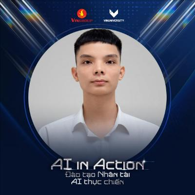
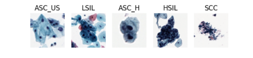
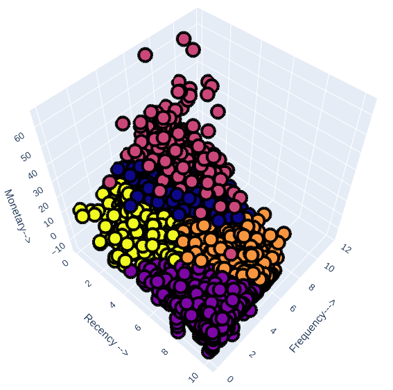

<b>🌴 AI Research Engineer</b>

    <a href="https://nthaihoc.github.io/about-me" title="Portfolio">:octicons-home-16:</a>
    <a href="mailto:thaihocit02@gmail.com" title="Email">:material-email:</a>
    <a href="https://github.com/nthaihoc" title="GitHub">:simple-github:</a>
    <a href="https://scholar.google.com/citations?user=SvS3rssAAAAJ&hl=vi" title="Google Scholar">:material-school:</a>
    <a href="../assets/files/curriculum_vitae.pdf" title="CV">:material-text-box-edit:</a>

## Bio

👋 Hello! I am **Nguyễn Thái Học**, an **AI Research Engineer** with a core focus on *Computer Vision* and **Machine Learning**. My journey with AI began in 2020, and tackling complex, real-world problems during my junior year at the [University of Information and Communication Technology (ICTU)](https://ictu.edu.vn) turned that initial curiosity into a dedicated career path.

Previously, I worked at the [Institute of Applied Science and Technology (IAST)](https://iast.ictu.edu.vn), where I progressed from a Computer Vision Intern (August 2023) to an official AI Engineer (August 2024), transitioning from theoretical foundations to building practical AI solutions for **Healthcare** and **Education**. Complementing this research background, I also completed a two-month intensive, hands-on stint at **VinSmart Future** through the **AI in Action** program, sharpening my ability to engineer and deliver production-ready AI systems in fast-paced environments.

Not stopping at traditional vision and machine learning pipelines, I am actively expanding my knowledge into **Large Language Models (LLMs)** and **Vision-Language Models (VLMs)**, while exploring **MLOps/LLMOps** to optimize end-to-end model deployment. To me, AI is more than just algorithms it is a tool to create positive, lasting change for society.

## News

- **[10/2026]** Graduated from the AI IN ACTION intensive training program at VinUniversity, including a two-month hands-on engineering stint at VinSmart Future.
- **[09/2026]** One research paper accepted for publication at the **5th International Conference on Advances in Information and Communication Technology (ICTA 2026)** in Ha Long.
- **[05/2026]** Admitted to the second cohort of the AI IN ACTION training program at **VinUniversity**.
- **[08/2024]** Promoted to official AI Engineer at [IAST](https://iast.ictu.edu.vn).
- **[07/2024]** Two research papers accepted for publication and oral presentation at the 3rd International Conference on Advances in Information and Communication Technology (ICTA 2024) in Phu Tho.
- **[08/2023]** Joined [IAST](https://iast.ictu.edu.vn) as a Computer Vision Intern.

## Tech Stack & Skills

- **:material-code-tags: Programming & Query Languages:** `Python` `C/C++` `SQL` `LaTeX`
- **:material-eye-outline: Computer Vision & ML/DL:** `PyTorch` `TensorFlow` `OpenCV` `Scikit-Learn` `Hugging Face`
- **:material-database-outline: Data Processing & Storage:** `NumPy` `Pandas` `Apache Spark` `Hadoop` `PostgreSQL` `MongoDB`
- **:material-docker: Deployment & Engineering Tools:** `Docker` `FastAPI` `MLflow` `Streamlit` `Git / GitHub` `Linux`

## Publications

- 

    **01.** [A Study on Ensemble Learning for Cervical Cytology Classification](https://)

    ---

    Van-Khanh Tran, **<u>Thai-Hoc Nguyen</u>**, Chi-Cuong Nghiem, Xuan-Lam Dinh

    *International Conference on Advances in Information and Communication Technology (ICTA), 2024.*

    **Keywords:** `Ensemble Learning` `Cervical Cancer Cytology` `Deep Learning`

- 

    **02.** [An automatic machine learning based customer segmentation model with RFM analysis](https://)

    ---

    Xuan-Thi Tran, **<u>Thai-Hoc Nguyen</u>**

    *International Conference on Advances in Information and Communication Technology (ICTA), 2024.*

    **Keywords:** `Customer Segmentation` `RFM` `K-means Clustering` `Hadoop` `Spark`

---