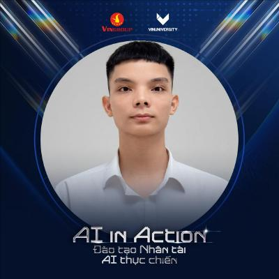
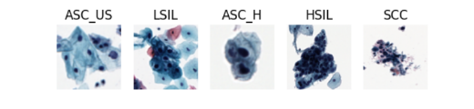
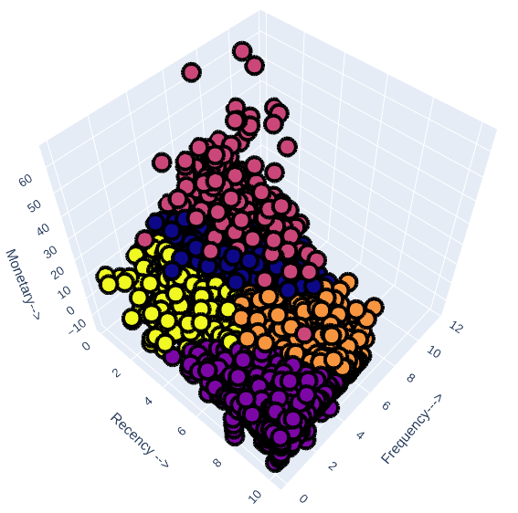

---
hide:
    - navigation
---

#

- 

    
<b>🌴 AI Research Engineer</b>

    

        <a href="https://nthaihoc.github.io/about-me" title="Portfolio">:octicons-home-16:</a>
        <a href="mailto:thaihocit02@gmail.com" title="Email">:material-email:</a>
        <a href="https://github.com/nthaihoc" title="GitHub">:simple-github:</a>
        <a href="https://scholar.google.com/citations?user=SvS3rssAAAAJ&hl=vi" title="Google Scholar">:material-school:</a>
        <a href="../assets/files/curriculum_vitae.pdf" title="CV">:material-text-box-edit:</a>
    

## Giới thiệu

👋 Xin chào! Tôi là **Nguyễn Thái Học**, một **AI Research Engineer** tập trung chuyên sâu vào *Thị giác Máy tính (Computer Vision)* và **Học máy (Machine Learning)**. Hành trình của tôi với Trí tuệ Nhân tạo bắt đầu từ năm 2020, và chính việc giải quyết các bài toán thực tiễn phức tạp vào năm thứ ba đại học tại [Trường Đại học Công nghệ Thông tin và Truyền thông (ICTU)](https://ictu.edu.vn) đã biến sự tò mò ban đầu ấy thành con đường sự nghiệp gắn bó lâu dài.

Trước đây, tôi từng công tác tại [Viện Khoa học và Công nghệ Ứng dụng (IAST)](https://iast.ictu.edu.vn), phát triển từ vị trí Thực tập sinh Thị giác Máy tính (tháng 8/2023) lên Kỹ sư AI chính thức (tháng 8/2024), chuyển dịch từ việc nắm vững nền tảng lý thuyết sang trực tiếp xây dựng các giải pháp AI thực tiễn cho lĩnh vực **Y tế** và **Giáo dục**. Bổ trợ cho nền tảng nghiên cứu này, tôi cũng đã hoàn thành kỳ thực chiến chuyên sâu kéo dài hai tháng tại **VinSmart Future** thông qua chương trình **AI in Action**, qua đó trau dồi khả năng thiết kế kỹ thuật và triển khai các hệ thống AI sẵn sàng vận hành thực tế trong môi trường tốc độ cao.

Không dừng lại ở các quy trình thị giác máy tính và học máy truyền thống, tôi đang tích cực mở rộng kiến thức sang **Các mô hình Ngôn ngữ Lớn (LLMs)** và **Các mô hình Thị giác - Ngôn ngữ (VLMs)**, đồng thời tìm hiểu sâu về **MLOps/LLMOps** nhằm tối ưu hóa quy trình triển khai mô hình đầu-cuối (end-to-end). Với tôi, AI không chỉ dừng lại ở những thuật toán mà còn là công cụ để tạo ra những thay đổi tích cực và bền vững cho xã hội.

## Tin tức

- **[10/2026]** Tốt nghiệp chương trình đào tạo chuyên sâu AI IN ACTION tại Đại học VinUni, bao gồm hai tháng thực chiến kỹ thuật trực tiếp tại VinSmart Future.
- **[09/2026]** Một bài báo khoa học được chấp nhận đăng tại **Hội nghị Quốc tế lần thứ 5 về Những tiến bộ trong Công nghệ Thông tin và Truyền thông (ICTA 2026)** tại Hạ Long.
- **[05/2026]** Trúng tuyển khóa thứ hai của chương trình đào tạo AI IN ACTION tại **Đại học VinUni**.
- **[08/2024]** Chính thức đảm nhận vị trí Kỹ sư AI tại [IAST](https://iast.ictu.edu.vn).
- **[07/2024]** Hai bài báo khoa học được chấp nhận đăng và trình bày trực tiếp tại Hội nghị Quốc tế lần thứ 3 về Những tiến bộ trong Công nghệ Thông tin và Truyền thông (ICTA 2024) tại Phú Thọ.
- **[08/2023]** Gia nhập [IAST](https://iast.ictu.edu.vn) với vai trò Thực tập sinh Thị giác Máy tính (Computer Vision Intern).

## Công nghệ & Kỹ năng

- **:material-code-tags: Ngôn ngữ Lập trình & Truy vấn:** `Python` `C/C++` `SQL` `LaTeX`
- **:material-eye-outline: Thị giác Máy tính & ML/DL:** `PyTorch` `TensorFlow` `OpenCV` `Scikit-Learn` `Hugging Face`
- **:material-database-outline: Xử lý & Lưu trữ Dữ liệu:** `NumPy` `Pandas` `Apache Spark` `Hadoop` `PostgreSQL` `MongoDB`
- **:material-docker: Triển khai & Công cụ Kỹ thuật:** `Docker` `FastAPI` `MLflow` `Streamlit` `Git / GitHub` `Linux`

## Công bố Khoa học

- 

    **01.** [A Study on Ensemble Learning for Cervical Cytology Classification](https://)

    ---

    Van-Khanh Tran, **<u>Thai-Hoc Nguyen</u>**, Chi-Cuong Nghiem, Xuan-Lam Dinh

    *International Conference on Advances in Information and Communication Technology (ICTA), 2024.*

    **Từ khóa:** `Ensemble Learning` `Cervical Cancer Cytology` `Deep Learning`

- 

    **02.** [An automatic machine learning based customer segmentation model with RFM analysis](https://)

    ---

    Xuan-Thi Tran, **<u>Thai-Hoc Nguyen</u>**

    *International Conference on Advances in Information and Communication Technology (ICTA), 2024.*

    **Từ khóa:** `Customer Segmentation` `RFM` `K-means Clustering` `Hadoop` `Spark`

---