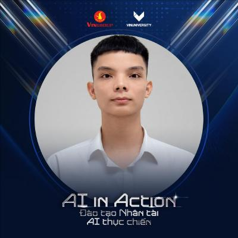
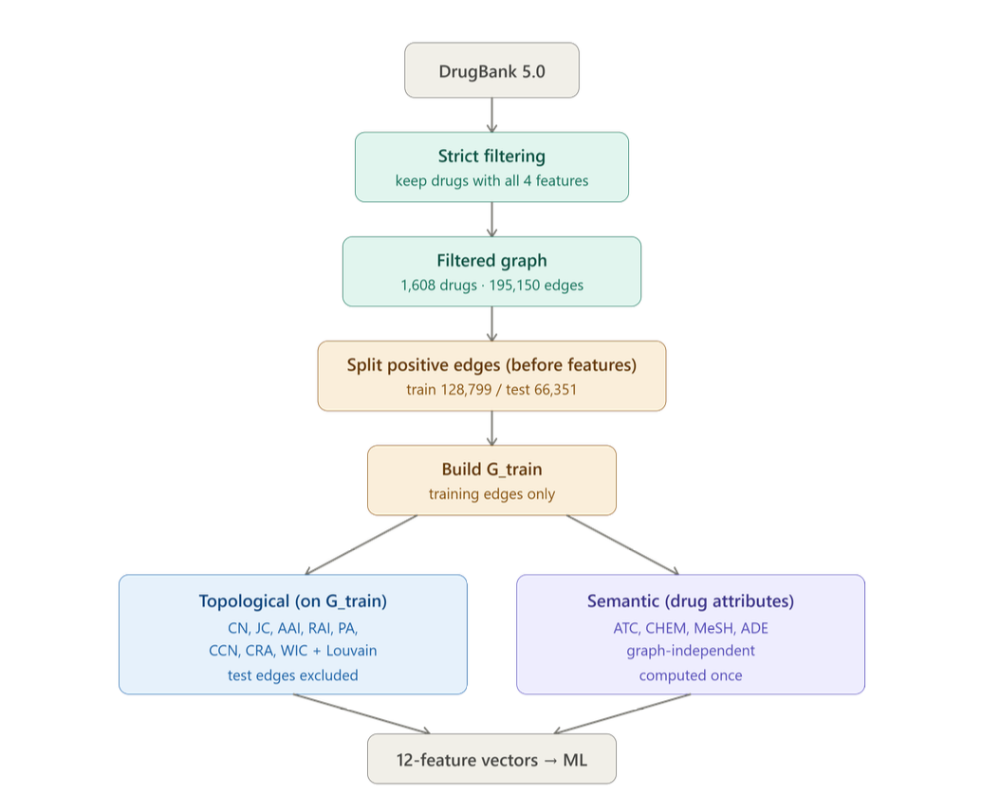
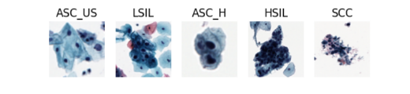
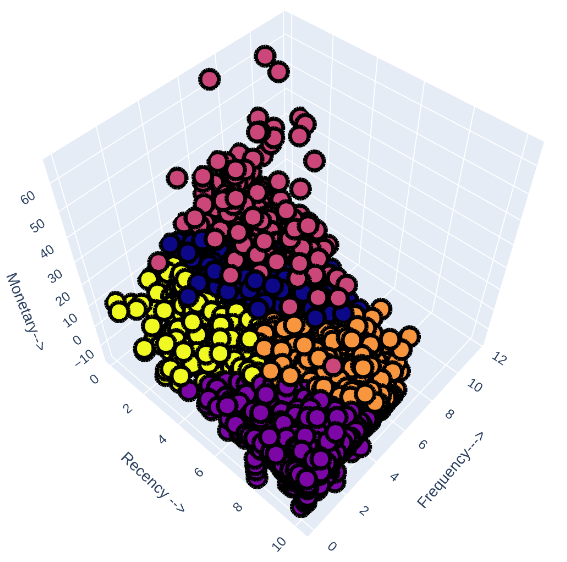

<b>:material-head-cog-outline: AI Research Engineer</b>

    <a href="https://nthaihoc.github.io/about-me" title="Portfolio">:octicons-home-16:</a>
    <a href="mailto:thaihocit02@gmail.com" title="Email">:material-email:</a>
    <a href="https://github.com/nthaihoc" title="GitHub">:simple-github:</a>
    <a href="https://scholar.google.com/citations?user=SvS3rssAAAAJ&hl=vi" title="Google Scholar">:material-school:</a>
    <a href="../assets/files/curriculum_vitae.pdf" title="CV">:material-text-box-edit:</a>

## Giới thiệu

Tôi là **Nguyễn Thái Học**, một **AI Research Engineer** chuyên sâu về **Computer Vision** và **Machine Learning**.

Hành trình AI của tôi bắt đầu từ nghiên cứu khoa học năm 2023 tại [Trường Đại học Công nghệ Thông tin và Truyền thông (ICTU)](https://ictu.edu.vn) dưới sự dẫn dắt của [**TS. Trần Xuân Thi**](https://scholar.google.com/citations?hl=vi&user=gSVGCr4AAAAJ&view_op=list_works&sortby=pubdate)[^ttxuan]. Sau đó, tôi gia nhập [Viện Khoa học và Công nghệ Ứng dụng (IAST)](https://iast.ictu.edu.vn), phát triển từ Thực tập sinh Thị giác máy tính lên Kỹ sư AI chính thức dưới sự hướng dẫn của [**TS. Đinh Xuân Lâm**](https://scholar.google.com/citations?hl=vi&user=YCPMvdoAAAAJ&view_op=list_works&sortby=pubdate)[^dxlam] và [**TS. Trần Văn Khánh**](https://scholar.google.com/citations?user=UB25SuUAAAAJ&hl=vi)[^tvkhanh], tập trung vào các bài toán **Y tế** và **Giáo dục** song song với công bố khoa học.

Năm 2026, tôi hoàn thành chương trình đào tạo chuyên sâu **AI IN ACTION** tại **VinUniversity** (bao gồm hai tháng thực chiến kỹ thuật tại **VinSmart Future**) nhằm hoàn thiện năng lực thiết kế và vận hành các hệ thống AI chuẩn thực tế. Hiện tại, tôi chủ động mở rộng chuyên môn sang **Large Language Models (LLMs)**, **Vision-Language Models (VLMs)** và **MLOps/LLMOps** để làm chủ trọn vẹn vòng đời từ mô hình đến sản phẩm. Với tôi, giá trị cốt lõi của AI nằm ở khả năng giải quyết gọn ghẽ các bài toán thực tiễn và tạo ra tác động bền vững.

[^ttxuan]: Viện phó, Viện Đào tạo Quốc tế – ICTU.
[^dxlam]: Viện trưởng, Viện Khoa học và Công nghệ Ứng dụng (IAST) – ICTU.
[^tvkhanh]: Viện trưởng, Viện Trí tuệ Nhân tạo – ICTU.

## Tin tức

- **[11/2026]** Trình bày trực tiếp (oral presentation) bài báo khoa học về dự đoán tương tác thuốc tại **Hội nghị Quốc tế lần thứ 5 về Những tiến bộ trong Công nghệ Thông tin và Truyền thông (ICTA 2026)** tại Hạ Long.
- **[10/2026]** Tốt nghiệp chương trình đào tạo chuyên sâu **AI IN ACTION** tại **VinUniversity**, bao gồm hai tháng thực chiến kỹ thuật tại **VinSmart Future**.
- **[09/2026]** Một bài báo khoa học được chấp nhận đăng tại **Hội nghị Quốc tế lần thứ 5 về Những tiến bộ trong Công nghệ Thông tin và Truyền thông (ICTA 2026)** tại Hạ Long.
- **[05/2026]** Trúng tuyển khóa 2 chương trình đào tạo **AI IN ACTION** tại **VinUniversity**.
- **[08/2024]** Trở thành Kỹ sư AI chính thức tại [IAST](https://iast.ictu.edu.vn).
- **[07/2024]** Hai bài báo khoa học được chấp nhận đăng và trình bày trực tiếp (oral presentation) tại **Hội nghị Quốc tế lần thứ 3 về Những tiến bộ trong Công nghệ Thông tin và Truyền thông (ICTA 2024)** tại Phú Thọ.
- **[08/2023]** Gia nhập [IAST](https://iast.ictu.edu.vn) với vai trò Thực tập sinh Thị giác máy tính.

## Công nghệ & Kỹ năng

- **:material-code-tags: Ngôn ngữ lập trình & Truy vấn:** `Python` `C/C++`
- **:material-eye-outline: Thị giác máy tính & ML/DL:** `PyTorch` `TensorFlow` `OpenCV` `Scikit-Learn` `Hugging Face`
- **:material-database-outline: Xử lý & Lưu trữ dữ liệu:** `NumPy` `Pandas` `Apache Spark` `Hadoop` `PostgreSQL` `MongoDB`
- **:material-docker: Triển khai & Công cụ kỹ thuật:** `Docker` `FastAPI` `MLflow` `Streamlit` `Git / GitHub` `Linux`

## Công bố khoa học

- 

    **01. Improving Drug-Drug Interaction Prediction via SHAP-Based Feature Selection and Ensemble Learning**

    ---

    Ngoc-Thien Vu, **<u>Thai-Hoc Nguyen</u>**, Van-Khanh Tran

    *International Conference on Advances in Information and Communication Technology (ICTA), 2026.*

    **Từ khóa:** `Drug-Drug Interaction` `SHAP` `Feature Selection` `Ensemble Learning`

- 

    **02. A Study on Ensemble Learning for Cervical Cytology Classification**

    ---

    Van-Khanh Tran, **<u>Thai-Hoc Nguyen</u>**, Chi-Cuong Nghiem, Xuan-Lam Dinh

    *International Conference on Advances in Information and Communication Technology (ICTA), 2024.*

    **Từ khóa:** `Ensemble Learning` `Cervical Cancer Cytology` `Deep Learning`

- 

    **03. An automatic machine learning based customer segmentation model with RFM analysis**

    ---

    Xuan-Thi Tran, **<u>Thai-Hoc Nguyen</u>**

    *International Conference on Advances in Information and Communication Technology (ICTA), 2024.*

    **Từ khóa:** `Customer Segmentation` `RFM` `K-means Clustering` `Hadoop` `Spark`

