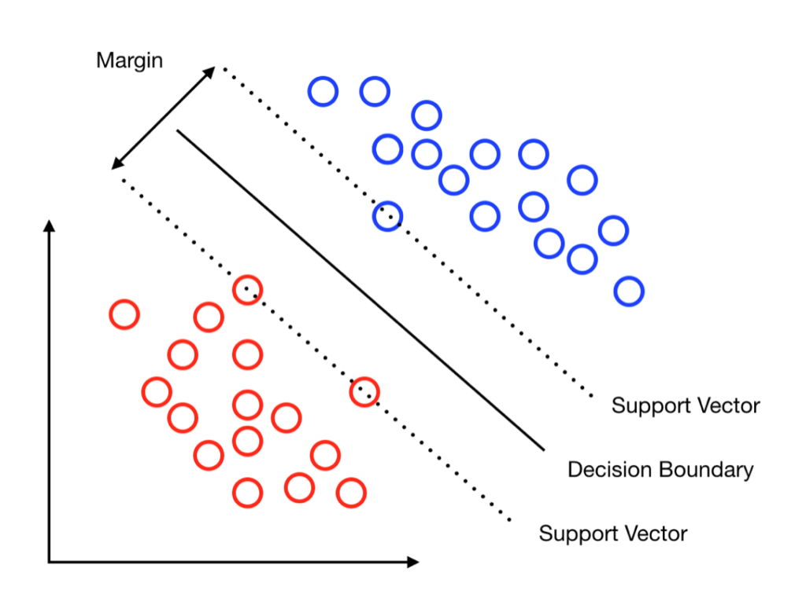
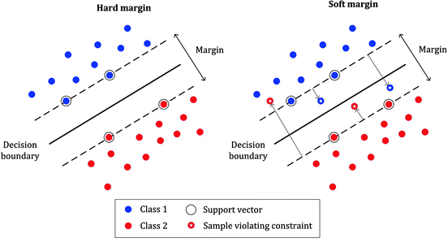
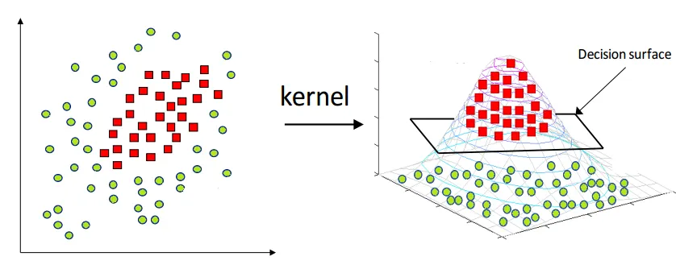



## Theoretical Foundations
---
**Support Vector Machine (SVM)** là một thuật toán Học Máy mạnh mẽ và linh hoạt, đặc biệt hiệu quả trên các tập dữ liệu có kích thước vừa và nhỏ. Thuật toán này có khả năng giải quyết đa dạng các bài toán từ phân loại tuyến tính, phi tuyến cho đến hồi quy và phát hiện điểm bất thường (outlier detection).

Ý tưởng cốt lõi của SVM là tìm kiếm một **hyperplane** (siêu mặt phẳng) không chỉ phân tách hai lớp dữ liệu mà còn duy trì khoảng cách xa nhất có thể tới các điểm huấn luyện gần nhất của mỗi lớp. Ta có thể hình dung mô hình đang cố gắng mở rộng một "con đường" phân cách rộng nhất có thể giữa hai nhóm dữ liệu. Vì lý do này, SVM còn được gọi là **Large Margin Classification** (phân loại lề lớn).

<div class="figure-environment">
    <div class="subfigure-container">
        <figure class="subfigure">
            
        </figure>
    </div>
</div>

/// caption
**Hình 1:** Minh họa không gian hai chiều của thuật toán SVM, thể hiện ranh giới quyết định tối ưu được xây dựng dựa trên nguyên lý tối đa hóa **margin** (lề) giữa các **support vectors** (vector hỗ trợ) của hai lớp dữ liệu.
///

<!-- <div class="figure-environment" markdown="1">
<div class="subfigure-container" markdown="1">
<figure class="subfigure" markdown="1">
  
  <figcaption markdown="span">(a) **Hard Margin** ($C \to \infty$)</figcaption>
</figure>
<figure class="subfigure" markdown="1">
  
  <figcaption markdown="span">(b) **Soft Margin** ($C = 1.0$)</figcaption>
</figure>
</div>
</div> -->

### Preliminaries
---
Xét tập dữ liệu huấn luyện gồm $m$ mẫu $\mathcal{D} = \left\{ \left[\mathbf{x}^{(i)}, y^{(i)}\right] \right\}_{i=1}^m$, trong đó mỗi điểm dữ liệu đầu vào là một vector đặc trưng $\mathbf{x}^{(i)} \in \mathbb{R}^d$ và nhãn nhị phân tương ứng thuộc tập đối xứng $y^{(i)} \in \{-1, +1\}$. Trong thực tế lập trình, nếu nhãn đầu vào được gán là $\{0, 1\}$, các thư viện sẽ tự động ánh xạ nội bộ về $\{-1, +1\}$ để đảm bảo tính đối xứng hình học của biên quyết định.

Hàm quyết định tuyến tính của SVM được định nghĩa bởi siêu mặt phẳng phân tách $f[\mathbf{x}] = 0$ (**Phương trình 1**), với $\mathbf{w} \in \mathbb{R}^d$ là vector pháp tuyến (trọng số) và $b \in \mathbb{R}$ là hệ số chặn (bias). Dựa vào dấu của $f[\mathbf{x}]$, mô hình gán nhãn dự đoán $\hat{y}$ cho một mẫu bất kỳ $\mathbf{x} \in \mathbb{R}^d$:

$$\begin{equation} 
f[\mathbf{x}] = \mathbf{w}^\top \mathbf{x} + b, \quad \hat{y} = \text{sign}\left[f[\mathbf{x}]\right] = \begin{cases} +1 & \text{nếu } f[\mathbf{x}] \ge 0 \\ -1 & \text{nếu } f[\mathbf{x}] < 0 \end{cases} \tag{1} 
\end{equation}$$

### Hard-margin
---
Mô hình **Hard-margin** (biên cứng) giả định tập dữ liệu huấn luyện có thể **tách biệt tuyến tính tuyệt đối** (linearly separable) — tức tồn tại ít nhất một cặp $(\mathbf{w}, b)$ phân loại chính xác $100\%$ các điểm dữ liệu mà không có nhiễu hay sự chồng lấn giữa hai lớp.

Về mặt hình học, khoảng cách từ một điểm $\mathbf{x}^{(i)}$ bất kỳ đến siêu mặt phẳng quyết định là $\dfrac{\left|f[\mathbf{x}^{(i)}]\right|}{\|\mathbf{w}\|_2}$. Vì phương trình siêu mặt phẳng bất biến với phép nhân vô hướng khác $0$, ta luôn có thể chuẩn hóa tỷ lệ của $(\mathbf{w}, b)$ sao cho tại các điểm gần biên nhất (**support vectors**), hàm quyết định đạt giá trị $\left|f[\mathbf{x}^{(i)}]\right| = 1$. Khi đó:

* Khoảng cách từ siêu mặt phẳng tới mỗi biên lề bằng $\dfrac{1}{\|\mathbf{w}\|_2}$, suy ra tổng độ rộng của lề phân cách là $\dfrac{2}{\|\mathbf{w}\|_2}$.
* Mọi mẫu dương ($y^{(i)} = +1$) phải thỏa mãn $\mathbf{w}^\top \mathbf{x}^{(i)} + b \ge 1$ và mọi mẫu âm ($y^{(i)} = -1$) phải thỏa mãn $\mathbf{w}^\top \mathbf{x}^{(i)} + b \le -1$.

Gộp hai điều kiện phân loại đúng thành một bất phương trình duy nhất, bài toán tối đa hóa độ rộng lề $\dfrac{2}{\|\mathbf{w}\|_2}$ tương đương với bài toán quy hoạch cực tiểu hóa chuẩn $\|\mathbf{w}\|_2$ sau đây (**Phương trình 2**):

$$\begin{equation} 
\min_{\mathbf{w}, b} \frac{1}{2} \mathbf{w}^\top \mathbf{w}, \quad \text{sao cho } y^{(i)} \left[ \mathbf{w}^\top \mathbf{x}^{(i)} + b \right] \ge 1, \quad \forall i = 1, 2, \dots, m \tag{2} 
\end{equation}$$

!!! tip "Tại sao cực tiểu hóa $\frac{1}{2}\|\mathbf{w}\|_2^2$ thay vì $\|\mathbf{w}\|_2$?"

    Biểu thức căn bậc hai trong chuẩn Euclid $\displaystyle{\|\mathbf{w}\|_2 = \sqrt{\sum_{j=1}^d w_j^2}}$ không khả vi tại gốc tọa độ và gây phức tạp cho việc tính đạo hàm. Thay vào đó, ta chuyển sang cực tiểu hóa một nửa bình phương chuẩn $\displaystyle{\frac{1}{2}\|\mathbf{w}\|_2^2 = \frac{1}{2}\mathbf{w}^\top \mathbf{w}}$. Vì $\|\mathbf{w}\|_2 \ge 0$, phép biến đổi đơn điệu này giữ nguyên vị trí nghiệm tối ưu nhưng biến hàm mục tiêu thành một hàm bậc hai lồi (convex quadratic) trơn tru, thuận tiện cho giải tích.

### Soft-margin
---
Trong thực tế, dữ liệu hiếm khi tách biệt tuyến tính hoàn hảo mà luôn tồn tại nhiễu và sự giao thoa giữa các lớp. Để khắc phục điểm yếu của biên cứng, **Soft-margin** (biên mềm) được đề xuất (**Hình 2**). Bằng cách nới lỏng các ràng buộc hình học, thuật toán cho phép một số điểm dữ liệu được phép lấn vào vùng lề hoặc nằm sai phía ranh giới, qua đó nâng cao khả năng tổng quát hóa của mô hình.

<div class="figure-environment">
    <div class="subfigure-container">
        <figure class="subfigure">
            
        </figure>
    </div>
</div>

/// caption
**Hình 2:** So sánh trực quan giữa SVM Hard-margin và SVM Soft-margin.
///

Để đo lường mức độ vi phạm ranh giới của từng mẫu huấn luyện thứ $i$, mô hình đưa vào một **slack variable** (biến bù) $\xi_i \ge 0$. Lúc này, bài toán đối mặt với hai mục tiêu xung đột nhau:

- Cực tiểu hóa $\displaystyle{\sum_{i=1}^m \xi_i}$ để hạn chế tối đa các điểm vi phạm biên (giảm lỗi phân loại trên tập huấn luyện).

- Cực tiểu hóa $\displaystyle{\frac{1}{2}\mathbf{w}^\top \mathbf{w}}$ để giữ độ rộng lề lớn nhất có thể (giảm nguy cơ overfitting).

Siêu tham số phạt $C > 0$ được đưa vào để kiểm soát sự đánh đổi (trade-off) giữa hai mục tiêu trên. Bài toán tối ưu của Soft-margin SVM trở thành:

$$
\begin{equation}
\begin{aligned} 
& \min_{\mathbf{w}, b, \boldsymbol{\xi}} \left[ \frac{1}{2} \mathbf{w}^\top \mathbf{w} + C \sum_{i=1}^m \xi_i \right], \\ 
& \text{sao cho } y^{(i)} \left[ \mathbf{w}^\top \mathbf{x}^{(i)} + b \right] \ge 1 - \xi_i, \quad \xi_i \ge 0, \quad \forall i = 1, 2, \dots, m
\end{aligned} \tag{3}
\end{equation}
$$

Cả bài toán Hard-margin và Soft-margin đều là bài toán quy hoạch lồi bậc hai với các ràng buộc tuyến tính. Để tìm nghiệm tối ưu cho dạng bài toán này, ta sử dụng kỹ thuật **Quadratic Programming (QP)**. Chi tiết cách thiết lập ma trận đầu vào cho bộ giải QP được trình bày ở [Appendix A](#appendix-a-quadratic-programming).

### Dual Problem
---

Bài toán gốc của Soft-margin SVM bị trói buộc bởi $2m$ điều kiện bất đẳng thức cứng (gồm $m$ ràng buộc biên và $m$ ràng buộc không âm của biến bù $\xi_i$). Các phương pháp đạo hàm thông thường không thể giải trực tiếp trên một miền nghiệm bị giới hạn bởi các bất đẳng thức như vậy.

Để giải quyết nút thắt này, ta áp dụng phương pháp **Nhân tử Lagrange**, chuyển bài toán có ràng buộc thành một bài toán tối ưu không ràng buộc thông qua việc gán các hệ số phạt không âm cho từng điều kiện:

* **Ràng buộc biên:** $1 - \xi_i - y^{(i)}\left[\mathbf{w}^\top \mathbf{x}^{(i)} + b\right] \le 0$ gắn với nhân tử $\alpha_i \ge 0$.
* **Ràng buộc tính dương:** $-\xi_i \le 0$ gắn với nhân tử $\mu_i \ge 0$.

Hàm **Lagrangian** $\mathcal{L}$ được thiết lập bằng cách cộng hàm mục tiêu gốc với các hạng tử ràng buộc:

$$
\begin{equation} 
\begin{aligned} 
\mathcal{L} \left[\mathbf{w}, b, \boldsymbol{\xi}, \boldsymbol{\alpha}, \boldsymbol{\mu}\right] 
=& \underbrace{\frac{1}{2} \Vert{}\mathbf{w}\Vert{}^2 + C\sum^m_{i=1}\xi_i}_{\text{Hàm mục tiêu gốc}} \\ 
&+ \sum^m_{i=1}\alpha_i \underbrace{\Bigl[1 - \xi_i - y^{(i)}\left[\mathbf{w}^\top\mathbf{x}^{(i)} + b\right]\Bigr]}_{\text{Ràng buộc biên}} \\ 
&- \sum^m_{i=1}\mu_i \cdot \underbrace{\xi_i}_{\text{Ràng buộc } \xi_i \ge 0} 
\end{aligned} \tag{4}
\end{equation}
$$

Lúc này bài toán trở thành một trò chơi đối kháng **min-max**, cực tiểu hóa $\mathcal{L}$ theo các biến gốc $(\mathbf{w}, b, \boldsymbol{\xi})$ và cực đại hóa $\mathcal{L}$ theo các nhân tử đối ngẫu $(\boldsymbol{\alpha}, \boldsymbol{\mu})$.

**Áp dụng điều kiện tối ưu KKT (Karush-Kuhn-Tucker):** Tại điểm yên ngựa tối ưu, đạo hàm riêng của $\mathcal{L}$ theo từng biến gốc phải triệt tiêu bằng $0$ (chi tiết khai triển xem tại [Appendix B](#appendix-b-kkt-with-dual-problem)):

* **Đạo hàm theo $\mathbf{w}$:**

$$
\begin{equation} 
\frac{\partial \mathcal{L}}{\partial \mathbf{w}} = \mathbf{w} - \sum_{i=1}^m \alpha_i y^{(i)} \mathbf{x}^{(i)} = \mathbf{0} \quad \Longrightarrow \quad \mathbf{w} = \sum_{i=1}^m \alpha_i y^{(i)} \mathbf{x}^{(i)} \tag{5} 
\end{equation}
$$

* **Đạo hàm theo $b$:**

$$
\begin{equation} \frac{\partial \mathcal{L}}{\partial b} = - \sum_{i=1}^m \alpha_i y^{(i)} = 0 \quad \Longrightarrow \quad \sum_{i=1}^m \alpha_i y^{(i)} = 0 \tag{6} 
\end{equation}
$$

* **Đạo hàm theo $\xi_i$:**
  
$$
\begin{equation} 
\frac{\partial \mathcal{L}}{\partial \xi_i} = C - \alpha_i - \mu_i = 0 \quad \Longrightarrow \quad \alpha_i + \mu_i = C \tag{7} 
\end{equation}
$$

Thế các **phương trình 5, 6, 7** ngược trở lại hàm $\mathcal{L}$ ở **phương trình 4**, toàn bộ các biến gốc $(\mathbf{w}, b, \boldsymbol{\xi})$ được khử sạch. Bài toán quy về dạng **Dual Problem** (bài toán đối ngẫu) chỉ còn phụ thuộc duy nhất vào vector nhân tử $\boldsymbol{\alpha}$:

$$
\begin{equation} 
\begin{aligned} 
\max_{\boldsymbol{\alpha}} W[\boldsymbol{\alpha}] &= \sum^m_{i=1} \alpha_i - \frac{1}{2} \sum^m_{i=1} \sum^m_{j=1} \alpha_i \alpha_j y^{(i)} y^{(j)} \left[\mathbf{x}^{(i)}\right]^\top \mathbf{x}^{(j)}; \\ 
&\text{sao cho } \sum^m_{i=1} \alpha_i y^{(i)} = 0 \quad \text{và} \quad 0 \le \alpha_i \le C, \quad \forall i = 1, \dots, m \tag{8}
\end{aligned}
\end{equation}
$$

### Kernel Trick
---
Trong dạng bài toán đối ngẫu (**phương trình 8**), dữ liệu huấn luyện không xuất hiện độc lập mà luôn đi theo từng cặp thông qua tích vô hướng $\left[\mathbf{x}^{(i)}\right]^\top \mathbf{x}^{(j)}$. Về mặt hình học, tích vô hướng phản ánh mức độ tương đồng giữa hai vector. Điều này bộc lộ một đặc tính quan trọng của SVM rằng thuật toán không cần biết tọa độ tuyệt đối của từng điểm dữ liệu, thứ duy nhất nó cần là thước đo mức độ giống nhau giữa các cặp điểm.

Tuy nhiên, tích vô hướng $\left[\mathbf{x}^{(i)}\right]^\top \mathbf{x}^{(j)}$ chỉ nắm bắt được tương quan tuyến tính trên không gian đặc trưng gốc. Đối với các tập dữ liệu đan xen phi tuyến (**Hình 3**), việc tìm kiếm một siêu mặt phẳng phân tách trực tiếp là bất khả thi.

<div class="figure-environment">
    <div class="subfigure-container">
        <figure class="subfigure">
            
        </figure>
    </div>
</div>

/// caption
**Hình 3:** Ranh giới quyết định của SVM trên dữ liệu phi tuyến tính.
///

Giải pháp tự nhiên là sử dụng một hàm ánh xạ phi tuyến $\phi \left[\mathbf{x}\right]$ để chiếu dữ liệu từ không gian $d$ chiều ban đầu lên một không gian mới có số chiều $D$ lớn hơn, nơi các lớp dữ liệu có thể tách biệt tuyến tính. Khi đó, tích vô hướng ban đầu được thay thế bằng $\phi \left[\mathbf{x}^{(i)}\right]^\top \phi\left[\mathbf{x}^{(j)}\right]$.

Thế nhưng, việc biến đổi tường minh toàn bộ dữ liệu qua $\phi \left[\mathbf{x}\right]$ rồi nhân vô hướng trên không gian $D$ chiều tạo ra một nút thắt cổ chai nghiêm trọng về bộ nhớ và tốc độ tính toán đặc biệt khi $D$ lên tới hàng triệu, thậm chí vô hạn chiều. Thay vì tính toán trực tiếp trên không gian cao chiều, toán học cho phép chúng ta đi đường vòng thông qua cơ chế ánh xạ ngầm định.

!!! failure "**Định lý Mercer và Cốt lõi của Kernel**"
    Theo hệ quả từ **Định lý Mercer**, chúng ta không cần biết biểu thức tường minh của hàm ánh xạ $\phi\left[\mathbf{x}\right]$, cũng không cần thực hiện phép biến đổi tọa độ dữ liệu lên không gian cao chiều. Chỉ cần xây dựng được một hàm $K\left[\mathbf{x}^{(i)}, \mathbf{x}^{(j)}\right]$ nhận đầu vào trực tiếp từ không gian gốc và thỏa mãn điều kiện đối xứng, nửa xác định dương (positive semi-definite), toán học đảm bảo luôn tồn tại một không gian Hilbert và một ánh xạ $\phi$ tương ứng sao cho $K\left[\mathbf{x}^{(i)}, \mathbf{x}^{(j)}\right] = \phi \left[\mathbf{x}^{(i)}\right]^\top \phi\left[\mathbf{x}^{(j)}\right]$.

Hàm $K$ được gọi là **Kernel function** (hàm hạt nhân), và kỹ thuật thay thế tích vô hướng $\phi \left[\mathbf{x}^{(i)}\right]^\top \phi \left[\mathbf{x}^{(j)} \right]$ bằng $$K\left[\mathbf{x}^{(i)}, \mathbf{x}^{(j)}\right]$$ được gọi là **Kernel Trick**. Hàm mục tiêu đối ngẫu lúc này được tổng quát hóa thành:

$$
\begin{equation}
\max_{\boldsymbol{\alpha}} W\left[\boldsymbol{\alpha}\right] = \sum^m_{i=1} \alpha_i - \frac{1}{2} \sum^m_{i=1} \sum^m_{j=1} \alpha_i \alpha_j y^{(i)} y^{(j)} K\left[\mathbf{x}^{(i)}, \mathbf{x}^{(j)}\right]
\tag{9}
\end{equation}
$$

!!! dagger "Giải phẫu cơ chế hoạt động của Kernel Trick"

    Để thấy rõ bản chất đại số của Kernel Trick, xét Polynomial Kernel bậc 2: $K\left[\mathbf{a}, \mathbf{b}\right] = \left[\mathbf{a}^\top \mathbf{b}\right]^2$ cho hai vector 2 chiều $\mathbf{a} = [a_1, a_2]^\top$ và $\mathbf{b} = [b_1, b_2]^\top$.

    **Cách 1 — Ánh xạ tường minh:** Dùng hàm $\phi$ chiếu vector từ $\mathbb{R}^2$ lên $\mathbb{R}^3$, sau đó tính tích vô hướng:

    $$
    \begin{equation}
    \begin{aligned}
    \phi[\mathbf{a}]^\top \phi[\mathbf{b}] &= 
    \begin{bmatrix} 
    {a_1}^2 \\[1ex]
    \sqrt{2}a_1a_2 \\[1ex] 
    {a_2}^2 
    \end{bmatrix}^\top
    \begin{bmatrix} 
    {b_1}^2 \\[1ex]
    \sqrt{2}b_1b_2 \\[1ex]
    {b_2}^2 \end{bmatrix} \\
    &= {a_1}^2{b_1}^2 + 2a_1b_1a_2b_2 + {a_2}^2{b_2}^2
    \tag{10}
    \end{aligned}
    \end{equation}
    $$

    **Cách 2 — Dùng Kernel Trick:** Tính tích vô hướng ngay trên không gian $\mathbb{R}^2$ gốc rồi bình phương kết quả:

    $$
    \begin{equation}
    \begin{aligned}
    K[\mathbf{a}, \mathbf{b}] &= \left[\mathbf{a}^\top \mathbf{b} \right]^2 \\
    &= \left[ \begin{bmatrix}a_1 \\ a_2\end{bmatrix}^\top \begin{bmatrix}b_1 \\ b_2\end{bmatrix} \right]^2 \\
    &= \left(a_1b_1 + a_2b_2\right)^2 \\
    &= {a_1}^2{b_1}^2 + 2a_1b_1a_2b_2 + {a_2}^2{b_2}^2
    \tag{11}
    \end{aligned}
    \end{equation}
    $$

    Hai phép tính trả về cùng một giá trị đại số chính xác, nhưng Cách 2 hoàn toàn không cần khởi tạo hay lưu trữ các vector trung gian ở không gian 3 chiều.

Tóm lại, lợi ích lớn nhất của Kernel Trick là giúp ta tạo ra được các ranh giới phân loại phi tuyến phức tạp mà không cần bận tâm không gian đặc trưng mới có bao nhiêu chiều $D$. Mọi phép tính đều được thực hiện trực tiếp trên dữ liệu $d$ chiều ban đầu, tránh hoàn toàn việc phải biến đổi dữ liệu sang không gian khổng lồ. Tuy nhiên, dưới góc nhìn kỹ thuật khi triển khai thực tế, phép biến đổi này đi kèm một đánh đổi rõ rệt:

- **Huấn luyện chậm khi số lượng mẫu ($m$) lớn:** Ở pha huấn luyện vì chưa biết điểm nào là support vector, bộ giải tối ưu buộc phải tính độ tương đồng giữa tất cả các cặp điểm dữ liệu với nhau để lập thành một bảng đối chiếu kích thước $m \times m$. Nếu tập dữ liệu có $100.000$ mẫu, bảng này sẽ chứa tới $10$ tỷ phần tử khiến quá trình huấn luyện tốn nhiều RAM và chạy rất chậm.

- **Lưu trữ sau huấn luyện rất nhẹ:** Bảng $m \times m$ khổng lồ kể trên chỉ dùng tạm lúc tìm nghiệm tối ưu. Ngay khi huấn luyện xong, chúng được xóa sạch khỏi bộ nhớ; mô hình chỉ giữ lại một nhóm nhỏ các support vectors ($\alpha_i > 0$) để phục vụ cho bước dự đoán sau này.

### Non-linear SVM Inference
---
Khi chuyển từ pha huấn luyện sang pha dự đoán (inference), **Kernel SVM** vận hành theo một cơ chế hoàn toàn khác biệt so với các mô hình tuyến tính hay mạng nơ-ron học sâu:

- **Với mô hình tham số (Linear SVM, Logistic Regression, Neural Networks):** Toàn bộ tri thức học được từ dữ liệu được nén gọn vào một tập trọng số cố định $\mathbf{w}$ và $b$. Sau khi huấn luyện xong, dữ liệu gốc bị xóa bỏ hoàn toàn; khi có mẫu mới $\mathbf{x}^{(new)}$, mô hình chỉ cần nhân trực tiếp $\mathbf{x}^{(new)}$ với trọng số $\mathbf{w}$ rồi cộng thêm $b$.

- **Với Kernel SVM:** Khi sử dụng các hàm kernel phổ biến như **RBF Kernel**[^rbf] để ánh xạ dữ liệu sang một không gian đặc trưng có số chiều vô hạn ($\mathbf{w} \in \mathbb{R}^\infty$), máy tính không thể tính toán hay lưu trữ một vector trọng số $\mathbf{w}$ dài vô tận trong RAM.

[^rbf]: **RBF Kernel (Radial Basis Function - Hàm cơ sở xuyên tâm):** Có dạng $K\left[\mathbf{x}, \mathbf{z}\right] = \exp\left[-\gamma \Vert{}\mathbf{x} - \mathbf{z}\Vert{}^2\right]$, dùng để đo mức độ tương đồng giữa hai điểm dữ liệu dựa trên khoảng cách Euclidean của chúng (càng gần nhau giá trị càng tiến về $1$, càng xa càng tiến về $0$).

Thay vì lưu $\mathbf{w}$, mô hình Kernel SVM đã huấn luyện chỉ lưu lại 3 thành phần ngay tại không gian gốc: (1) danh sách các support vector $\mathbf{x}^{(i)}$ với $\alpha_i > 0$; (2) các hệ số đối ngẫu tương ứng $\alpha_i y^{(i)}$; và (3) hệ số chặn $b$.

**Thế ngược** $\mathbf{w}$ **để dự đoán không cần không gian cao chiều.**

Về mặt lý thuyết, hàm quyết định cho một điểm dữ liệu mới $\mathbf{x}^{(new)}$ có dạng:

$$
\begin{equation}
f\left[\mathbf{x}^{(new)}\right] = \mathbf{w}^\top \phi\left[\mathbf{x}^{(new)}\right] + b
\tag{12}
\end{equation}
$$

Từ điều kiện tối ưu KKT của bài toán đối ngẫu (**phương trình 5**), ta biết rằng tại điểm nghiệm tối ưu, vector trọng số $\mathbf{w}$ luôn bằng tổ hợp tuyến tính của các điểm dữ liệu trong không gian đặc trưng. Vì không thể tính ra con số cụ thể cho $\mathbf{w}$, ta giữ nguyên biểu thức cấu thành này và thế thẳng vào hàm quyết định. Phép thế này giúp đưa $\phi\left[\mathbf{x}^{(new)}\right]$ vào bên trong dấu tổng để ghép cặp trực tiếp với từng $\phi \left[\mathbf{x}^{(i)}\right]$:

$$
\begin{equation}
\begin{aligned}
f\left[\mathbf{x}^{(new)}\right]
&= \left[ \sum_{i=1}^m \alpha_i y^{(i)} \phi[\mathbf{x}^{(i)}] \right]^\top \phi[\mathbf{x}^{(new)}] + b \\[1.5ex]
&= \sum_{i=1}^m \alpha_i y^{(i)} \left[ \phi[\mathbf{x}^{(i)}]^\top \phi[\mathbf{x}^{(new)}] \right] + b
\end{aligned}
\tag{13}
\end{equation}
$$

Tại đây, tích vô hướng $\phi[\mathbf{x}^{(i)}]^\top \phi[\mathbf{x}^{(new)}]$ được thay thế ngay bằng hàm hạt nhân $K[\mathbf{x}^{(i)}, \mathbf{x}^{(new)}]$, triệt tiêu hoàn toàn sự phụ thuộc vào không gian vô hạn chiều. Hơn nữa, vì đại đa số các điểm dữ liệu nằm ngoài vùng biên đều có $\alpha_i = 0$, ta chỉ cần tính tổng trên tập các support vectors $\mathcal{S} = \{i \mid \alpha_i > 0\}$:

$$
\begin{equation}
\hat{y}^{(new)} = \text{sign} \left[ \sum_{i \in \mathcal{S}} \alpha_i y^{(i)} K\left[\mathbf{x}^{(i)}, \mathbf{x}^{(new)}\right] + b \right]
\tag{14}
\end{equation}
$$

Nói cách khác, thay vì so sánh $\mathbf{x}^{(new)}$ với một siêu mặt phẳng $\mathbf{w}$ cố định, Kernel SVM đem $\mathbf{x}^{(new)}$ đi đo độ tương đồng trực tiếp với từng support vector đã lưu, sau đó lấy tổng có trọng số $\alpha_i y^{(i)}$ để quyết định nhãn.

**Tính toán hệ số chặn** $b$

Tương tự như $\mathbf{w}$, hệ số $b$ không xuất hiện trực tiếp trong nghiệm đối ngẫu $\boldsymbol{\alpha}$ mà phải được suy ngược lại thông qua hàm Kernel. Về mặt hình học, sau khi đã xác định được độ nghiêng của ranh giới qua $\boldsymbol{\alpha}$, ta chỉ cần tìm tọa độ của một điểm nằm chính xác trên đường biên lề để cố định vị trí của siêu mặt phẳng.

Theo điều kiện lơi lỏng bù trừ của Soft-margin SVM, không phải mọi support vector đều nằm trên đường biên (những điểm nhiễu có $\alpha_i = C$ thường nằm lấn vào bên trong vùng lề). Chỉ những support vectors thỏa mãn điều kiện **$0 < \alpha_s < C$** (tương ứng biến bù $\xi_s = 0$) mới nằm đè khít lên hai đường biên $+1$ và $-1$, tức là đạt dấu bằng tuyệt đối:

$$
\begin{equation}
y^{(s)} \left[ \sum_{i \in \mathcal{S}} \alpha_i y^{(i)} K\left[\mathbf{x}^{(i)}, \mathbf{x}^{(s)}\right] + b \right] = 1
\tag{15}
\end{equation}
$$

Nhân cả hai vế với $y^{(s)}$ do tính chất $[y^{(s)}]^2 = 1$ vì $y^{(s)} \in \{-1, +1\}$ rồi chuyển vế để cô lập $b$:

$$
\begin{equation}
b = y^{(s)} - \sum_{i \in \mathcal{S}} \alpha_i y^{(i)} K\left[\mathbf{x}^{(i)}, \mathbf{x}^{(s)}\right]
\tag{16}
\end{equation}
$$

Về mặt lý thuyết, mọi điểm nằm trên biên đều cho ra cùng một giá trị $b$. Tuy nhiên, trong triển khai thực tế, để giảm thiểu sai số làm tròn dấu phẩy động của máy tính, hệ số $b$ được tính bằng trung bình cộng trên toàn bộ tập các điểm nằm đúng trên đường biên $\mathcal{M} = \{s \mid 0 < \alpha_s < C\}$:

$$
\begin{equation}
b = \frac{1}{|\mathcal{M}|} \sum_{s \in \mathcal{M}} \left[ y^{(s)} - \sum_{i \in \mathcal{S}} \alpha_i y^{(i)} K\left[\mathbf{x}^{(i)}, \mathbf{x}^{(s)}\right] \right]
\tag{17}
\end{equation}
$$

Toàn bộ vòng đời của Kernel SVM hoàn toàn không cần sự tồn tại của vector $\mathbf{w}$. Tuy nhiên, cái giá phải trả là thời gian dự đoán cho một mẫu mới tỷ lệ thuận với số lượng support vectors. Dữ liệu càng nhiều nhiễu, số lượng support vectors phải lưu lại càng lớn, kéo theo dung lượng file mô hình phình to và tốc độ dự đoán chậm đi đáng kể.

### Hinge Loss
---
Xuyên suốt các phần trước, chúng ta đã tiếp cận và giải quyết SVM dưới góc độ quy hoạch toàn phương thông qua bài toán đối ngẫu. Phương pháp này mang lại sự chặt chẽ về mặt toán học và mở đường cho thủ thuật Kernel. Tuy nhiên, khi áp dụng vào thực tiễn với các tập dữ liệu lớn, cách tiếp cận này vấp phải hai rào cản kỹ thuật:

- **Độ phức tạp tính toán:** Giải bài toán đối ngẫu đòi hỏi việc lưu trữ và xử lý ma trận Kernel kích thước $m \times m$. Độ phức tạp thời gian từ $O(m^2)$ đến $O(m^3)$ dễ dàng gây tràn bộ nhớ khi $m$ lên tới hàng triệu mẫu.

- **Thiếu tính linh hoạt:** Các bộ giải quy hoạch toàn phương truyền thống hoạt động theo cơ chế học theo lô (Batch Learning), yêu cầu nạp toàn bộ dữ liệu cùng một lúc. Khi có thêm dữ liệu mới, ta buộc phải huấn luyện lại từ đầu thay vì cập nhật trực tuyến (Online Learning).

Để phá vỡ rào cản này , ta quay lại bài toán gốc ở **phương trình** **3**. Thay vì dùng nhân tử Lagrange để xử lý các bất đẳng thức ràng buộc, ta rút điều kiện $\xi_i \ge 1 - y^{(i)}\left[\mathbf{w}^\top \mathbf{x}^{(i)} + b\right]$ kết hợp với $\xi_i \ge 0$ thành $\xi_i = \max\left[0, 1 - y^{(i)}\left[\mathbf{w}^\top \mathbf{x}^{(i)} + b\right]\right]$ rồi thế thẳng vào hàm mục tiêu. Bài toán SVM lúc này trở thành một hàm mục tiêu không ràng buộc duy nhất:

$$
\begin{equation}
\mathcal{J}[\mathbf{w}, b] = \frac{1}{2} \left\|\mathbf{w}\right\|^2 + C \sum^m_{i=1} \max \left[0, 1 - y^{(i)} \left[\mathbf{w}^\top \mathbf{x}^{(i)} + b\right]\right]
\tag{18}
\end{equation}
$$

**Phương trình 18** tách cấu trúc của SVM tuyến tính thành hai thành phần độc lập:

-  Cụm $\displaystyle{\frac{1}{2} \Vert{}\mathbf{w}\Vert{}^2}$ chính là kỹ thuật điều chuẩn L2 (L2 Regularization), giúp cực đại hóa độ rộng lề và kiểm soát độ phức tạp của mô hình để ngăn ngừa overfitting.

- Thành phần $\max \left[0, 1 - y^{(i)} \left[\mathbf{w}^\top \mathbf{x}^{(i)} + b\right] \right]$ được gọi là **Hinge Loss**, đo lường mức độ vi phạm lề của từng mẫu dữ liệu. Nếu điểm dữ liệu nằm đúng phía và ngoài vùng biên an toàn $y^{(i)}\left[\mathbf{w}^\top \mathbf{x}^{(i)} + b\right] \ge 1$, hàm trả về $0$ (không phạt), ngược lại mức phạt tăng tuyến tính theo độ sâu vi phạm.

Việc đưa SVM về dạng hàm mất mát không ràng buộc $\mathcal{J}[\mathbf{w}, b]$ cho phép ta sử dụng các thuật toán tối ưu dựa trên đạo hàm bậc nhất như **Stochastic Gradient Descent (SGD)** hoặc **Coordinate Descent**, giúp huấn luyện nhanh trên các tập dữ liệu khổng lồ nhưng vẫn đảm bảo tối ưu chi phí tài nguyên.

## Implementation
---
Sau khi đã nắm vững nền tảng toán học của bài toán tối ưu lề lớn và thủ thuật Kernel Trick, bước tiếp theo là hiện thực hóa thuật toán bằng Python. Trong phần này, chúng ta sẽ sử dụng lớp `SVC` từ thư viện `scikit-learn` để huấn luyện và đánh giá mô hình SVM trên bộ dữ liệu kinh điển **Iris**[^iris].

[^iris]: Bộ dữ liệu **Iris** được nhà thống kê và thực vật học **Ronald Fisher** giới thiệu vào năm 1936. Tập dữ liệu bao gồm $150$ mẫu hoa thuộc ba loài khác nhau: *Iris setosa*, *Iris versicolor* và *Iris virginica* (mỗi loài $50$ mẫu), được mô tả qua bốn đặc trưng hình thái học (chiều dài và chiều rộng của đài hoa, cánh hoa). Đây là bộ dữ liệu tiêu chuẩn dùng để kiểm chứng trực quan các thuật toán phân loại.

**Lộ trình thực nghiệm:**

1. Kiểm tra môi trường và nạp các module cần thiết từ `scikit-learn`.
2. Tải dữ liệu Iris, trích xuất không gian đặc trưng $2$ chiều và phân chia tập huấn luyện/kiểm thử theo cơ chế stratifiled (phân tầng). 
3. Chuẩn hóa đặc trưng về cùng thang đo tiêu chuẩn nhằm đảm bảo tính ổn định cho bài toán tối ưu lồi.
4. Khởi tạo mô hình `SVC` với các tham số điều chuẩn $C$, hàm nhân tương ứng và trực quan hóa kết quả phân loại.

**Thiết lập môi trường & Nạp dữ liệu.** Đầu tiên, ta nạp các thư viện tính toán khoa học cốt lõi cùng các công cụ tiền xử lý, mô hình hóa và đánh giá từ `scikit-learn`:

```python linenums="1" exec="1" session="svm" source="material-block" result="text"
import io  # markdown-exec: hide
import base64  # markdown-exec: hide

import numpy as np
import pandas as pd
import matplotlib
matplotlib.use("Agg")  # markdown-exec: hide
import matplotlib.pyplot as plt

import sklearn
from sklearn import datasets
from sklearn.model_selection import train_test_split
from sklearn.preprocessing import StandardScaler
from sklearn.svm import SVC
from sklearn.metrics import accuracy_score

print(f"NumPy version: {np.__version__}")
print(f"Pandas version: {pd.__version__}")
print(f"Scikit-learn version: {sklearn.__version__}")
```

Mỗi mẫu hoa trong bộ dữ liệu Iris vốn được biểu diễn trong không gian $4$ chiều $\mathbf{x} \in \mathbb{R}^4$ gồm: *sepal length* (chiều dài đài hoa), *sepal width* (chiều rộng đài hoa), *petal length* (chiều dài cánh hoa) và *petal width* (chiều rộng cánh hoa). Để dễ dàng quan sát trực quan sự phân bố các điểm dữ liệu trên mặt phẳng $2D$, ta chỉ trích xuất hai đặc trưng giàu thông tin nhất của cánh hoa là chiều dài và chiều rộng cánh hoa đưa vào ma trận đặc trưng $\mathbf{X} \in \mathbb{R}^{150 \times 2}$, trong khi vector nhãn mục tiêu $\mathbf{y}$ lưu trữ mã số của ba loài hoa (`0`, `1`, `2`):

```python linenums="1" exec="1" session="svm" source="material-block" result="text"
iris = datasets.load_iris()
X = iris.data[:, [2, 3]]
y = iris.target

print(f"Full feature vector (sample 0): {iris.data[0]}")
print(f"Class labels: {np.unique(y)}")
print(f"X shape: {X.shape} | y shape: {y.shape}")
print(f"Selected features (sample 0): {X[0]} -> Class: {y[0]}")
```

**Phân chia tập dữ liệu & Chuẩn hóa đặc trưng.** Để đánh giá khách quan khả năng tổng quát hóa của mô hình trên dữ liệu chưa từng thấy, ta dùng hàm `train_test_split` với `test_size=0.3` để tách dữ liệu gốc thành $70\%$ cho tập huấn luyện (`X_train`) và $30\%$ cho tập kiểm thử (`X_test`). Trong đó, tham số `random_state=42` cố định hạt giống ngẫu nhiên nhằm đảm bảo tính tái lặp, còn `stratify=y` kích hoạt cơ chế lấy mẫu phân tầng[^sta] giúp giữ nguyên tỷ lệ phân bố các lớp hoa ở cả hai tập con:

[^sta]: https://www.geeksforgeeks.org/machine-learning/how-to-implement-stratified-sampling-with-scikit-learn/

```python linenums="1" exec="1" session="svm" source="material-block" result="text"
X_train, X_test, y_train, y_test = train_test_split(
    X, y, test_size=0.3, random_state=42, stratify=y
)

print(f"X_train: {X_train.shape} | y_train: {y_train.shape}")
print(f"X_test:  {X_test.shape}  | y_test:  {y_test.shape}\n")

print(f"Class counts in y:       {np.bincount(y)}")
print(f"Class counts in y_train: {np.bincount(y_train)}")
print(f"Class counts in y_test:  {np.bincount(y_test)}")
```

Kết quả từ hàm `np.bincount` xác nhận mỗi lớp đều có đúng $35$ mẫu ở tập huấn luyện và $15$ mẫu ở tập kiểm thử. Tiếp theo, vì SVM tối ưu khoảng cách hình học dựa trên chuẩn Euclid $\Vert{}\mathbf{w}\Vert{}_2$, các đặc trưng có miền giá trị lớn sẽ lấn át các đặc trưng có miền giá trị nhỏ. Do đó, ta dùng lớp `StandardScaler` để đưa toàn bộ đặc trưng về phân phối chuẩn có trung bình $\mu = 0$ và độ lệch chuẩn $\sigma = 1$:

$$x_{\text{std}}^{(i)} = \frac{x^{(i)} - \mu}{\sigma}$$

```python linenums="1" exec="1" session="svm" source="material-block" result="text"
sc = StandardScaler()
sc.fit(X_train)
X_train_std = sc.transform(X_train)
X_test_std = sc.transform(X_test)

print(f"Standardized X_train[0]: {X_train_std[0]}")
print(f"Standardized X_test[0]:  {X_test_std[0]}")
```

!!! warning "Nguyên tắc chống rò rỉ dữ liệu (Data Leakage)"

    Phương thức `fit` chỉ được phép gọi duy nhất trên tập `X_train` để ước lượng các tham số thống kê $(\mu_{\text{train}}, \sigma_{\text{train}})$. Đối với tập kiểm thử `X_test`, ta chỉ gọi `transform` nhằm áp dụng đúng bộ tham số đã học từ tập huấn luyện, đảm bảo cả hai tập dữ liệu nằm trên cùng một hệ quy chiếu hình học và mô hình không nhìn trộm phân phối của dữ liệu tương lai.

**Huấn luyện mô hình & Đánh giá kết quả.** Bây giờ ta khởi tạo bộ phân loại `SVC` và gọi phương thức `fit` trên dữ liệu đã chuẩn hóa. Đối chiếu lại phần lý thuyết (**phương trình 3**), ta thiết lập `kernel="linear"` để sử dụng hàm nhân tuyến tính $K[\mathbf{x}^{(i)}, \mathbf{x}^{(j)}] = {\mathbf{x}^{(i)}}^\top \mathbf{x}^{(j)}$, kết hợp cùng tham số điều chuẩn `C=1.0` để kiểm soát mức phạt đối với các điểm vi phạm lề. Giá trị $C$ càng lớn thì biên lề càng hẹp và phạt nặng sai số huấn luyện, ngược lại $C$ nhỏ cho phép lề rộng hơn để chấp nhận nhiễu biên:

```python linenums="1" exec="1" session="svm" source="material-block" result="text"
svm = SVC(kernel="linear", C=1.0, random_state=42)
svm.fit(X_train_std, y_train)

y_pred = svm.predict(X_test_std)

df_results = pd.DataFrame({
    "y_true": y_test,
    "y_pred": y_pred,
    "correct": y_test == y_pred
})

acc = accuracy_score(y_test, y_pred)
print(f"Test Accuracy: {acc:.2%}\n")
print(df_results.head(10))
```

!!! note "Cách `SVC` xử lý bài toán phân loại đa lớp (Multi-class)"

    Mặc dù công thức toán học gốc của SVM được thiết kế cho phân loại nhị phân $y \in \{-1, +1\}$, lớp `SVC` trong `scikit-learn` tự động mở rộng sang bài toán $K$ lớp ($K=3$ trên tập Iris) thông qua chiến lược **One-vs-One (OvO)**: huấn luyện $\displaystyle{\frac{K(K-1)}{2} = 3}$ bộ phân loại nhị phân cho từng cặp lớp và tổng hợp nhãn cuối cùng bằng cơ chế bỏ phiếu đa số.

Quan sát bảng đối chiếu $10$ mẫu đầu tiên từ `df_results`, mô hình dự đoán chính xác $9/10$ mẫu (chỉ nhầm lẫn duy nhất ở mẫu có chỉ số `2` thuộc vùng chồng lấn giữa *Versicolor* và *Virginica*). Trên toàn bộ $45$ mẫu kiểm thử, hàm `accuracy_score` trả về độ chính xác đạt **$91.11\%$**.

Cuối cùng, ta trực quan hóa kết quả phân loại của mô hình trên không gian đặc trưng đã chuẩn hóa:

```python exec="on" source="material-block" session="svm" html="1"
def plot_predictions(X, y_predicted, class_names=None, xlabel="Petal length", ylabel="Petal width", title="SVM Classification Results on Iris Test Set"):
    styles = [
        ("#e41a1c", "o"),
        ("#377eb8", "s"),
        ("#4daf4a", "^"),
    ]
    if class_names is None:
        class_names = ["Setosa", "Versicolor", "Virginica"]

    fig, ax = plt.subplots(figsize=(7, 5), dpi=150)

    for label_id, name in enumerate(class_names):
        color, marker = styles[label_id % len(styles)]
        ax.scatter(
            X[y_predicted == label_id, 0],
            X[y_predicted == label_id, 1],
            c=color,
            marker=marker,
            label=name,
            edgecolors="black",
            alpha=0.85,
        )

    ax.set_xlabel(xlabel)
    ax.set_ylabel(ylabel)
    ax.set_title(title)
    ax.legend(loc="upper left", frameon=True)
    ax.grid(True, linestyle="--", alpha=0.4)
    fig.tight_layout()

    buf = io.BytesIO()  # markdown-exec: hide
    fig.savefig(buf, format="png", bbox_inches="tight")  # markdown-exec: hide
    plt.close(fig)  # markdown-exec: hide

    img_b64 = base64.b64encode(buf.getvalue()).decode("utf-8")  # markdown-exec: hide
    print(f'<div style="text-align: center;"></div>')  # markdown-exec: hide

plot_predictions(X_test_std, y_pred)
```

**Mở rộng sang bài toán phi tuyến với Kernel RBF.** Trên tập dữ liệu Iris vừa rồi, biên phân tách tuyến tính đã hoạt động khá tốt ($91.11\%$). Tuy nhiên, trong thực tế, dữ liệu thường phân bố phi tuyến phức tạp. Để thấy rõ sức mạnh của Kernel Trick, ta dùng `np.logical_xor` tạo một tập dữ liệu tổng hợp mô phỏng cổng logic **XOR** gồm $200$ mẫu ngẫu nhiên, nơi không tồn tại bất kỳ đường thẳng nào có thể phân tách hai lớp dữ liệu:

```python linenums="1" exec="1" session="svm" source="material-block" result="text"
np.random.seed(1)
X_xor = np.random.randn(200, 2)
y_xor = np.logical_xor(X_xor[:, 0] > 0, X_xor[:, 1] > 0)
y_xor = np.where(y_xor, 1, 0)

svm_linear_xor = SVC(kernel="linear", C=10.0, random_state=1)
svm_rbf_xor = SVC(kernel="rbf", gamma=0.10, C=10.0, random_state=1)

svm_linear_xor.fit(X_xor, y_xor)
svm_rbf_xor.fit(X_xor, y_xor)

print(f"Linear SVM accuracy on XOR: {svm_linear_xor.score(X_xor, y_xor):.2%}")
print(f"RBF SVM accuracy on XOR: {svm_rbf_xor.score(X_xor, y_xor):.2%}")
```

Kết quả từ phương thức `score` cho thấy mô hình tuyến tính chỉ đạt độ chính xác $63.00\%$, trong khi chỉ cần chuyển sang `kernel="rbf"`, SVM ánh xạ ngầm dữ liệu lên không gian vô hạn chiều và phân loại chính xác tới **$91.00\%$** mẫu dữ liệu XOR:

```python exec="on" source="material-block" session="svm" html="1"
plot_predictions(
    X_xor,
    svm_linear_xor.predict(X_xor),
    class_names=["Class 0", "Class 1"],
    xlabel="Feature 1",
    ylabel="Feature 2",
    title="Fig 1. Linear Kernel SVM Predictions on Non-linear XOR Dataset",
)

plot_predictions(
    X_xor,
    svm_rbf_xor.predict(X_xor),
    class_names=["Class 0", "Class 1"],
    xlabel="Feature 1",
    ylabel="Feature 2",
    title="Fig 2. RBF Kernel SVM Predictions on Non-linear XOR Dataset",
)
```

Quan sát trực quan hai biểu đồ dự đoán trên tập dữ liệu XOR cho thấy rõ sự khác biệt về bản chất hình học giữa hai hàm nhân. Do bị giới hạn bởi một siêu mặt phẳng duy nhất trong không gian $\mathbb{R}^2$, mô hình `kernel="linear"` buộc phải chia cắt mặt phẳng theo một đường chéo thẳng, khiến toàn bộ cụm điểm thuộc góc phần tư thứ III (nơi cả `Feature 1` và `Feature 2` đều âm) bị phân loại nhầm sang `Class 1` (**Hình 1**). Ngược lại, bằng cách ánh xạ ngầm dữ liệu lên không gian chiều cao hơn qua `kernel="rbf"`, mô hình nắm bắt trọn vẹn cấu trúc đối xứng bốn góc phần tư của hàm **XOR**, tách biệt chính xác hai nhóm điểm cùng dấu (`Class 0`) ở góc phần tư thứ I, III với hai nhóm điểm trái dấu (`Class 1`) ở góc phần tư thứ II, IV và chỉ mắc sai số nhỏ tại vùng giao nhau sát gốc tọa độ (**Hình 2**).

**Ảnh hưởng của siêu tham số $\gamma$ tới độ phức tạp mô hình.** Trong hàm nhân Gaussian RBF, tham số $\gamma$ kiểm soát bán kính ảnh hưởng của từng điểm dữ liệu huấn luyện lên biên quyết định: khi $\gamma$ nhỏ (như `gamma=0.2`), phạm vi ảnh hưởng rộng tạo ra biên phân tách trơn mượt dễ dẫn đến underfitting, ngược lại khi $\gamma$ lớn (như `gamma=100.0`), bán kính ảnh hưởng co hẹp khiến biên uốn lượn ôm sát từng điểm riêng lẻ và gây ra overfitting. Ta kiểm chứng trực tiếp hiện tượng này trên tập Iris bằng cách theo dõi đồng thời số lượng vector hỗ trợ qua thuộc tính `support_` và độ chính xác `score` khi tăng dần `gamma`:

```python linenums="1" exec="1" session="svm" source="material-block" result="text"
for gamma_val in [0.2, 10.0, 100.0]:
    svm_gamma = SVC(kernel="rbf", gamma=gamma_val, C=1.0, random_state=42)
    svm_gamma.fit(X_train_std, y_train)
    train_acc = svm_gamma.score(X_train_std, y_train)
    test_acc = svm_gamma.score(X_test_std, y_test)
    n_sv = len(svm_gamma.support_)
    print(
        f"gamma={gamma_val:<5} | Support Vectors: {n_sv:>3}/105 | "
        f"Train Acc: {train_acc:.2%} | Test Acc: {test_acc:.2%}"
    )
```

Kết quả thực nghiệm thể hiện rõ sự đánh đổi qua ba ngưỡng $\gamma$: 

- ở `gamma=0.2`, mô hình chỉ huy động $36/105$ vector hỗ trợ với biên quyết định quá trơn nên độ chính xác kiểm thử dừng ở **$91.11\%$**.

- Tại điểm cân bằng `gamma=10.0`, số lượng vector hỗ trợ giữ ổn định ở mức $37/105$ nhưng độ cong của biên khớp vừa vặn với phân bố phi tuyến giúp nâng độ chính xác kiểm thử lên **$95.56\%$**.
  
- Ngưỡng `gamma=100.0`, số vector hỗ trợ tăng vọt lên $74/105$ (hơn $70\%$ tập huấn luyện) do mô hình cô lập từng điểm riêng lẻ, kéo độ chính xác kiểm thử tụt ngược về **$91.11\%$**.

**Kiến trúc thực thi & Tối ưu quy mô lớn.** Dưới góc độ kỹ thuật phần mềm, lớp `SVC` trong `scikit-learn` thực chất là một lớp bọc gọi xuống thư viện **LIBSVM** viết bằng C/C++ để giải bài toán quy hoạch toàn phương, nhưng giải thuật này có độ phức tạp bộ nhớ và thời gian tăng nhanh theo số lượng mẫu ($\mathcal{O}(m^2)$ đến $\mathcal{O}(m^3)$). Khi làm việc với các tập dữ liệu lớn không thể nạp trọn vào bộ nhớ RAM, `scikit-learn` cung cấp giải pháp thay thế thông qua lớp `SGDClassifier` nhằm tối ưu trực tiếp hàm mất mát **Hinge Loss** bằng thuật toán **Stochastic Gradient Descent** và hỗ trợ học trực tuyến.

```python linenums="1" exec="1" session="svm" source="material-block" result="text"
from sklearn.linear_model import SGDClassifier

svm_sgd = SGDClassifier(
    loss="hinge", 
    alpha=0.01, 
    max_iter=1000, 
    random_state=42
)
svm_sgd.fit(X_train_std, y_train)

print(f"SGD Linear SVM | Test Accuracy: {svm_sgd.score(X_test_std, y_test):.2%}")
```

!!! tip "Lựa chọn công cụ phù hợp với quy mô dữ liệu"
    * **Dữ liệu vừa và nhỏ ($m < 50{,}000$), cần biên phi tuyến phức tạp:** Ưu tiên dùng `SVC(kernel="rbf")` trên nền tảng `LIBSVM`.
    * **Dữ liệu lớn hoặc luồng dữ liệu trực tuyến (streaming data):** Chuyển sang `SGDClassifier(loss="hinge")` hoặc `LinearSVC` trên nền tảng `LIBLINEAR` để tối ưu tốc độ và tài nguyên bộ nhớ.

<!-- ## Appendix A: Quadratic Programming
---
Một bộ giải quy hoạch toàn phương (Quadratic Programming - QP) tiêu chuẩn không biết khái niệm siêu mặt phẳng hay biên lề; nó chỉ nhận đầu vào theo một khuôn mẫu ma trận cố định:

$$
\begin{equation}
\min_{\mathbf{p}} \frac{1}{2}\mathbf{p}^\top \mathbf{H}\mathbf{p} + \mathbf{f}^\top \mathbf{p}, \quad \text{sao cho } \mathbf{A}\mathbf{p} \le \mathbf{b}_{qp}
\tag{18}
\end{equation}
$$

Trong bài toán Hard-margin SVM với $d$ đặc trưng, ta cần tìm hệ số chặn $b$ và vector trọng số $\mathbf{w} = [w_1, w_2, \dots, w_d]^\top$, nhưng bộ giải QP chỉ nhận một vector ẩn duy nhất $\mathbf{p}$. Do đó, ta gộp chúng thành một vector cột kích thước $n_p = d + 1$:

$$\mathbf{p} = \left[ b, w_1, \dots, w_d \right]^\top$$

SVM cần cực tiểu hóa $\frac{1}{2}\|\mathbf{w}\|^2$ mà không phạt độ lớn của $b$. Để cụm $\mathbf{p}^\top \mathbf{H}\mathbf{p}$ sinh ra đúng tổng bình phương các trọng số $w_1^2 + \dots + w_d^2$ và triệt tiêu $b$, ma trận $\mathbf{H}$ kích thước $(d+1) \times (d+1)$ được thiết lập là ma trận đơn vị với phần tử đầu tiên $\mathbf{H}_{00} = 0$:

$$
\begin{equation}
\mathbf{H} \cdot \mathbf{p} =
\begin{bmatrix}
0 & 0 & \dots & 0 \\
0 & 1 & \dots & 0 \\
\vdots & \vdots & \ddots & \vdots \\
0 & 0 & \dots & 1
\end{bmatrix}
\begin{bmatrix}
b \\
w_1 \\
\vdots \\
w_d
\end{bmatrix}
= 
\begin{bmatrix}
0 \\
w_1 \\
\vdots \\
w_d
\end{bmatrix}
\tag{19}
\end{equation}
$$

Nhân tiếp với $\mathbf{p}^\top$ ở bên trái:

$$
\begin{equation}
\mathbf{p}^\top (\mathbf{H}\mathbf{p}) =
\left[ b, w_1, \dots, w_d \right]
\begin{bmatrix}
0 \\
w_1 \\
\vdots \\
w_d
\end{bmatrix}
= 0 + w_1^{2} + \dots + w_d^{2} = \|\mathbf{w}\|^2
\tag{20}
\end{equation}
$$

Thêm hệ số $\frac{1}{2}$, ta thu được chính xác hàm mục tiêu của SVM. Đồng thời, ta gán vector $\mathbf{f} = \mathbf{0} \in \mathbb{R}^{d+1}$ để loại bỏ hoàn toàn hạng tử bậc nhất $\mathbf{f}^\top \mathbf{p}$.

Về phần ràng buộc, điều kiện gốc của SVM là $y^{(i)}(\mathbf{w}^\top \mathbf{x}^{(i)} + b) \ge 1$. Vì bộ giải QP yêu cầu dấu bất đẳng thức nhỏ hơn hoặc bằng ($\le$), ta nhân cả hai vế với $-1$:

$$-y^{(i)} \left( \mathbf{w}^\top \mathbf{x}^{(i)} + b \right) \le -1$$

Vế trái chính là tích vô hướng giữa hàng thứ $i$ của ma trận $\mathbf{A}$ (ký hiệu $\mathbf{a}^{(i)}$) với vector cột $\mathbf{p}$. Bằng cách thêm phần tử $1$ vào đầu vector đặc trưng $\mathbf{x}^{(i)} = [x_1^{(i)}, \dots, x_d^{(i)}]$, ta có:

$$
\begin{equation}
\left[ 1, x_1^{(i)}, x_2^{(i)}, \dots, x_d^{(i)} \right]
\begin{bmatrix}
b \\
w_1 \\
w_2 \\
\vdots \\
w_d
\end{bmatrix}
=
b + x_1^{(i)}w_1 + x_2^{(i)}w_2 + \dots + x_d^{(i)}w_d
\tag{21}
\end{equation}
$$

Nhân hàng này với $-y^{(i)}$, ta thu được cấu trúc chuẩn cho hàng thứ $i$ của ma trận $\mathbf{A}$: $\mathbf{a}^{(i)} = -y^{(i)} \left[ 1, x_1^{(i)}, x_2^{(i)}, \dots, x_d^{(i)} \right]$. Kiểm chứng lại bằng phép nhân với $\mathbf{p}$:

$$
\begin{equation}
\mathbf{a}^{(i)} \mathbf{p} = \left( -y^{(i)} \left[ 1, x_1^{(i)}, x_2^{(i)}, \dots, x_d^{(i)} \right] \right)
\begin{bmatrix}
b \\
w_1 \\
\vdots \\
w_d
\end{bmatrix}
=
-y^{(i)} \left( b + x_1^{(i)}w_1 + \dots + x_d^{(i)}w_d \right)
\tag{22}
\end{equation}
$$

Tổng hợp lại, bài toán tìm vector tối ưu $\mathbf{p}^* = \left[ b^*, w_1^*, \dots, w_d^* \right]^\top$ được đưa về hệ quy hoạch toàn phương hoàn chỉnh:

$$
\begin{equation}
\min_{\mathbf{p}} \frac{1}{2}\mathbf{p}^\top \mathbf{H}\mathbf{p} + \mathbf{f}^\top \mathbf{p}, \quad
\text{sao cho } \mathbf{A}\mathbf{p} \le \mathbf{b}_{qp}
\tag{23}
\end{equation}
$$

Trong đó bộ 4 tham số đầu vào được định nghĩa chặt chẽ như sau:

* $\mathbf{H}$: Ma trận vuông kích thước $(d+1) \times (d+1)$, với $\mathbf{H}_{00} = 0$ và các phần tử trên đường chéo chính còn lại bằng $1$.
* $\mathbf{f}$: Vector cột kích thước $(d+1) \times 1$ chứa toàn bộ giá trị $0$.
* $\mathbf{A}$: Ma trận ràng buộc kích thước $m \times (d+1)$ (với $m$ là số mẫu huấn luyện), mỗi hàng có dạng theo ****phương trình** 22**.
* $\mathbf{b}_{qp}$: Vector cột kích thước $m \times 1$ chứa toàn bộ giá trị $-1$.

Khi nạp bộ tham số $(\mathbf{H}, \mathbf{f}, \mathbf{A}, \mathbf{b}_{qp})$ này vào các thư viện tối ưu như `CVXOPT`, bộ giải sẽ trả về vector nghiệm $\mathbf{p}^*$. Từ đó, phần tử đầu tiên chính là hệ số chặn $b^*$ và $d$ phần tử còn lại là vector trọng số $\mathbf{w}^*$. Cách thiết lập tương tự cũng được mở rộng cho Soft-margin SVM bằng cách nối thêm $m$ biến bù $\xi_i$ vào vector ẩn $\mathbf{p}$.

## Appendix B: KKT with Dual Problem
---

Để chuẩn bị cho việc lấy đạo hàm riêng, ta phá ngoặc ****phương trình** 4** và gom nhóm các hạng tử theo từng biến gốc $(\mathbf{w}, b, \boldsymbol{\xi})$:

$$
\begin{equation}
\begin{aligned}
\mathcal{L}(\mathbf{w}, b, \boldsymbol{\xi}, \boldsymbol{\alpha}, \boldsymbol{\mu}) =& \ \frac{1}{2}\|\mathbf{w}\|^2
 + C \sum_{i=1}^m \xi_i \\
&+ \sum_{i=1}^m \alpha_i
 - \sum_{i=1}^m \alpha_i \xi_i
 - \sum_{i=1}^m \alpha_i y^{(i)} \mathbf{w}^\top \mathbf{x}^{(i)} 
 - \sum_{i=1}^m \alpha_i y^{(i)} b \\
&- \sum_{i=1}^m \mu_i \xi_i \\
=& \ \frac{1}{2}\|\mathbf{w}\|^2 - \left( \sum^m_{i=1}\alpha_i y^{(i)} \mathbf{x}^{(i)} \right)^\top \mathbf{w} \\
&- b \sum_{i=1}^m \alpha_i y^{(i)} \\
&+ \sum_{i=1}^m \xi_i \left( C - \alpha_i - \mu_i \right) \\
&+ \sum_{i=1}^m \alpha_i
\end{aligned}
\tag{24}
\end{equation}
$$

Áp dụng điều kiện dừng KKT, ta lần lượt tính đạo hàm riêng của $\mathcal{L}$ theo các biến gốc và cho bằng $0$:

**Đạo hàm theo $\mathbf{w}$:**

$$ 
\begin{equation}
\frac{\partial \mathcal{L}}{\partial \mathbf{w}} = \mathbf{w} - \sum_{i=1}^m \alpha_i y^{(i)} \mathbf{x}^{(i)} = \mathbf{0} \quad \Longrightarrow \quad \mathbf{w} = \sum_{i=1}^m \alpha_i y^{(i)} \mathbf{x}^{(i)} 
\tag{25}
\end{equation}
$$

**phương trình** này cho thấy vector trọng số tối ưu $\mathbf{w}$ luôn là một tổ hợp tuyến tính của các điểm dữ liệu huấn luyện. Những điểm nằm ngoài vùng biên an toàn có $\alpha_i = 0$ sẽ không đóng góp vào $\mathbf{w}$; chỉ những điểm có $\alpha_i > 0$ mới tham gia định hình siêu mặt phẳng phân tách và được gọi là **Support Vectors**.

**Đạo hàm theo $b$:**

$$ 
\begin{equation}
\frac{\partial \mathcal{L}}{\partial b} = - \sum_{i=1}^m \alpha_i y^{(i)} = 0 \quad \Longrightarrow \quad \sum_{i=1}^m \alpha_i y^{(i)} = 0 
\tag{26}
\end{equation}
$$

Điều kiện này đảm bảo sự cân bằng lực giữa hai lớp: tổng trọng số $\alpha_i$ của các Support Vectors thuộc lớp dương ($y^{(i)} = +1$) luôn bằng tổng trọng số $\alpha_i$ của các Support Vectors thuộc lớp âm ($y^{(i)} = -1$).

**Đạo hàm theo $\xi_i$:**

$$ 
\begin{equation}
\frac{\partial \mathcal{L}}{\partial \xi_i} = C - \alpha_i - \mu_i = 0 \quad \Longrightarrow \quad \alpha_i + \mu_i = C 
\tag{27}
\end{equation}
$$

Vì cả hai nhân tử Lagrange đều không âm ($\alpha_i \ge 0$ và $\mu_i \ge 0$), **phương trình** này giới hạn chặt giá trị của $\alpha_i$ trong đoạn $[0, C]$: $0 \le \alpha_i \le C$. Nhờ đó, ngay cả khi một điểm nhiễu (outlier) vi phạm biên nghiêm trọng, mức độ ảnh hưởng tối đa của nó lên siêu mặt phẳng vẫn bị khóa trần ở ngưỡng $C$. Bên cạnh đó, nghiệm tối ưu còn phải thỏa mãn điều kiện lơi lỏng bù trừ (Complementary Slackness):
1. $\alpha_i \left[ 1 - \xi_i - y^{(i)}(\mathbf{w}^\top \mathbf{x}^{(i)} + b) \right] = 0$
2. $\mu_i \xi_i = 0$

Tiếp theo, ta thế ngược các điều kiện đạo hàm trở lại hàm $\mathcal{L}$ để triệt tiêu toàn bộ biến gốc $(\mathbf{w}, b, \boldsymbol{\xi})$. Trước hết, thay ****phương trình** 26** và ****phương trình** 27** vào **biểu thức 24**, các hạng tử chứa $b$ và $\xi_i$ tự động bằng $0$:

$$
\begin{equation}
\mathcal{L} = \frac{1}{2} \left\|\mathbf{w}\right\|^2 - \left(\sum^m_{i=1} \alpha_i y^{(i)} \mathbf{x}^{(i)}\right)^\top \mathbf{w} + \sum^m_{i=1} \alpha_i
\tag{28}
\end{equation}
$$

Thay tiếp biểu thức của $\mathbf{w}$ từ ****phương trình** 25** vào cụm tổng trong **công thức 28**:

$$
\begin{equation}
\mathcal{L} = \frac{1}{2} \left\|\mathbf{w}\right\|^2 - \mathbf{w}^\top \mathbf{w} + \sum^m_{i=1} \alpha_i
\tag{29}
\end{equation}
$$

Vì $\mathbf{w}^\top \mathbf{w} = \|\mathbf{w}\|^2$, biểu thức rút gọn thành:

$$
\begin{equation}
\mathcal{L} = \sum^m_{i=1} \alpha_i - \frac{1}{2} \left\|\mathbf{w}\right\|^2
\tag{30}
\end{equation}
$$

Cuối cùng, khai triển $\|\mathbf{w}\|^2 = \mathbf{w}^\top \mathbf{w}$ theo ****phương trình** 25**:

$$
\begin{equation}
\left\|\mathbf{w}\right\|^2 = \left(\sum^m_{i=1} \alpha_i y^{(i)} \mathbf{x}^{(i)}\right)^\top \left(\sum^m_{j=1} \alpha_j y^{(j)} \mathbf{x}^{(j)}\right) =
\sum^m_{i=1} \sum^m_{j=1} \alpha_i \alpha_j y^{(i)} y^{(j)} (\mathbf{x}^{(i)})^\top \mathbf{x}^{(j)}
\tag{31}
\end{equation}
$$

Thế ****phương trình** 31** vào ****phương trình** 30**, ta thu được hàm mục tiêu đối ngẫu hoàn chỉnh $W(\boldsymbol{\alpha})$:

$$
\begin{equation}
\begin{aligned}
\max_{\boldsymbol{\alpha}} W(\boldsymbol{\alpha}) &= \sum^m_{i=1} \alpha_i - \frac{1}{2} \sum^m_{i=1} \sum^m_{j=1} \alpha_i \alpha_j y^{(i)} y^{(j)} (\mathbf{x}^{(i)})^\top \mathbf{x}^{(j)} \\
&\text{sao cho } \sum^m_{i=1} \alpha_i y^{(i)} = 0 \quad \text{và} \quad 0 \le \alpha_i \le C, \quad \forall i = 1, \dots, m
\end{aligned}
\tag{32}
\end{equation}
$$ -->

## References
---
\bibliography