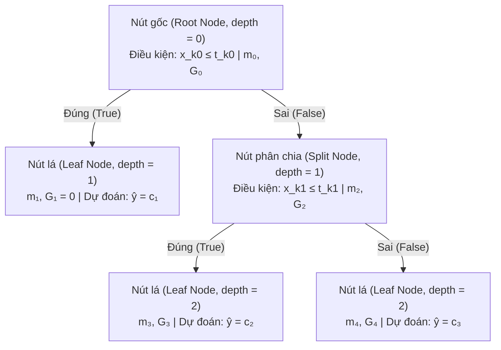



<!-- Source: 01-decision-tree.pdf, Chapter 5, Pages 179–193 -->

## Theoretical Foundations

<!-- Source: 01-decision-tree.pdf, Chapter 5 Introduction, Page 179 -->

**Cây quyết định (Decision Tree)** là một lớp thuật toán học máy đa năng, có khả năng giải quyết đồng thời bài toán **phân loại (classification)**, **hồi quy (regression)** và **đa đầu ra (multioutput tasks)**. Nhờ cấu trúc phân tách đệ quy không đặt giả định tham số chặt chẽ về dạng hàm phân phối, cây quyết định có thể khớp tốt các tập dữ liệu có ranh giới phi tuyến phức tạp, đồng thời đóng vai trò là **thành phần kiến trúc nền tảng** cho các mô hình tổ hợp mạnh như **Rừng Ngẫu nhiên (Random Forests)** [@geron2022hands].



/// caption
**Hình 1:** Cấu trúc trừu tượng của một cây quyết định nhị phân có độ sâu tối đa bằng $2$, minh họa luồng phân tách từ **Nút gốc (Root Node)** qua **Nút phân chia (Split Node)** tới các **Nút lá (Leaf Nodes)** cùng điều kiện ngưỡng $x_k \le t_k$, số mẫu $m_i$ và độ bất thuần $G_i$.
///

### Preliminaries

<!-- Source: 01-decision-tree.pdf, Chapter 5 — "Making Predictions" & "Model Interpretation", Pages 180–182 -->

Xét tập dữ liệu huấn luyện có nhãn gồm $m$ mẫu quan sát trong không gian đặc trưng $d$ chiều:

$$
\begin{equation}
\mathcal{D} = \left\{ \left[\mathbf{x}^{(i)}, y^{(i)}\right] \right\}_{i=1}^{m}, \quad \mathbf{x}^{(i)} \in \mathbb{R}^d, \quad y^{(i)} \in \mathcal{Y} \tag{1}
\end{equation}
$$

Trong **Phương trình 1**, $\mathbf{x}^{(i)} = \left[x_1^{(i)}, x_2^{(i)}, \dots, x_d^{(i)}\right]^\top$ là vector đặc trưng và $\mathcal{Y}$ là không gian nhãn mục tiêu: rời rạc $\mathcal{Y} = \{1, 2, \dots, K\}$ đối với bài toán phân loại $K$ lớp, hoặc liên tục $\mathcal{Y} \subseteq \mathbb{R}$ đối với bài toán hồi quy.[^notation]

[^notation]: Tài liệu nguồn [@geron2022hands] dùng ký hiệu $n$ cho cả số lớp (ở Công thức 5-1, 5-3) và số đặc trưng (ở độ phức tạp huấn luyện). Để tránh nhập nhằng về ký hiệu trong phần lý thuyết, bài giảng này phân biệt rõ $K$ là số lớp và $d$ là số chiều đặc trưng.

Cây quyết định nhị phân phân hoạch không gian đặc trưng $\mathbb{R}^d$ theo cấu trúc phân cấp gồm ba loại nút:

- **Nút gốc (Root node):** Nằm ở độ sâu $0$, tiếp nhận toàn bộ $m$ mẫu của $\mathcal{D}$ và đặt phép kiểm tra ngưỡng đầu tiên $x_{k} \le t_{k}$ trên một chiều đặc trưng $k \in \{1, \dots, d\}$.
- **Nút phân chia (Split node):** Là các nút trung gian tiếp tục chia đôi tập con dữ liệu nhận được bằng một cặp điều kiện $(k, t_k)$ mới; mỗi nút phân chia luôn có đúng hai nút con.
- **Nút lá (Leaf node):** Nút tận cùng không có nút con, gán giá trị dự đoán $\hat{y}$ cho toàn bộ mẫu đi vào vùng không gian tương ứng của nút đó.

Tại mỗi nút thứ $i$, mô hình lưu giữ số lượng mẫu huấn luyện rơi vào nút ($m_i$), phân bố số lượng mẫu theo từng lớp $\mathbf{c}_i = [c_{i,1}, \dots, c_{i,K}]^\top$ (với $\sum_{k=1}^K c_{i,k} = m_i$) và thước đo độ bất thuần của nút ($G_i$ hoặc $H_i$). Khi suy luận trên một mẫu mới $\mathbf{x} \in \mathbb{R}^d$, mẫu đi từ nút gốc xuống nhánh trái nếu $x_k \le t_k$ và xuống nhánh phải nếu ngược lại, lặp lại cho tới khi gặp nút lá.

!!! tip "Hai đặc tính bản chất của Cây quyết định"
    - **Không yêu cầu chuẩn hóa đặc trưng (Feature Scaling / Centering):** Do phép kiểm tra chỉ so sánh từng tọa độ đơn lẻ $x_k$ với ngưỡng $t_k$, các phép biến đổi đơn điệu hoặc co giãn tỷ lệ theo trục tọa độ không làm thay đổi cấu trúc phân hoạch của cây.
    - **Mô hình Hộp trắng (White-Box Model):** Khác với các mô hình "hộp đen" như mạng nơ-ron hay rừng ngẫu nhiên (vốn rất khó diễn giải nhân quả đằng sau từng dự đoán), cây quyết định cung cấp các luật phân loại tường minh, cho phép con người truy vết và kiểm chứng trực tiếp quy trình ra quyết định — đặc biệt quan trọng trong y tế, tài chính, tư pháp hay nhân sự.

---

### Gini Impurity & Ước lượng Xác suất Lớp

<!-- Source: 01-decision-tree.pdf, Chapter 5 — "Making Predictions" (Eq. 5-1) & "Estimating Class Probabilities", Pages 180–183 -->

Một nút thứ $i$ được gọi là **thuần khiết (pure)** khi toàn bộ $m_i$ mẫu tại nút đó đều thuộc về duy nhất một lớp. Để định lượng mức độ pha trộn giữa các lớp, **độ bất thuần Gini (Gini impurity)** tại nút $i$ được định nghĩa như sau:

$$
\begin{equation}
G_i = 1 - \sum_{k=1}^{K} p_{i,k}^{2} \tag{2}
\end{equation}
$$

Trong **Phương trình 2**, $p_{i,k} = \dfrac{c_{i,k}}{m_i}$ là tỷ lệ mẫu thuộc lớp $k$ trên tổng số $m_i$ mẫu huấn luyện tại nút thứ $i$. Khi nút thuần khiết ($p_{i,k^*} = 1$ tại một lớp $k^*$ và bằng $0$ ở mọi lớp còn lại), ta có $G_i = 0$. Ngược lại, khi các lớp phân bố đồng đều nhau tại nút đó, $G_i$ tiến tới giá trị cực đại $1 - \frac{1}{K}$.

Bên cạnh việc trả về nhãn rời rạc chiếm đa số tại nút lá, cây quyết định còn **ước lượng phân phối xác suất hậu nghiệm** cho một mẫu đầu vào $\mathbf{x}$ rơi vào nút lá thứ $i$ bằng đúng tỷ lệ thống kê của từng lớp tại nút lá đó:

$$
\begin{equation}
\hat{P}\left[y = k \mid \mathbf{x} \in R_i\right] = p_{i,k} = \frac{c_{i,k}}{m_i}, \qquad \hat{y}[\mathbf{x}] = \arg\max_{k \in \{1, \dots, K\}} p_{i,k} \tag{3}
\end{equation}
$$

Từ **Phương trình 3**, dễ thấy mọi điểm $\mathbf{x}$ nằm trong cùng một vùng phân hoạch hình chữ nhật $R_i$ gắn với nút lá $i$ sẽ nhận **cùng một vector xác suất dự đoán**, bất kể khoảng cách từ $\mathbf{x}$ tới ranh giới quyết định lớn hay nhỏ.

---

### Entropy & So sánh Thước đo Độ bất thuần

<!-- Source: 01-decision-tree.pdf, Chapter 5 — "Gini Impurity or Entropy?", Equation 5-3, Pages 184–185 -->

Ngoài độ bất thuần Gini, **Entropy** — khái niệm bắt nguồn từ nhiệt động lực học (đo mức độ hỗn loạn phân tử) và lý thuyết thông tin của Shannon (đo lượng thông tin trung bình của một thông điệp) — là thước đo độ bất thuần phổ biến thứ hai trong cây quyết định. Tại nút thứ $i$, Entropy $H_i$ được xác định bởi:

$$
\begin{equation}
H_i = -\sum_{\substack{k=1 \\ p_{i,k} \neq 0}}^{K} p_{i,k} \log_2 p_{i,k} \tag{4}
\end{equation}
$$

Trong **Phương trình 4**, tổng chỉ lấy trên các lớp có $p_{i,k} \neq 0$ (với quy ước giới hạn $\lim_{p \to 0^+} p \log_2 p = 0$). Khi tất cả mẫu tại nút thuộc cùng một lớp, mọi thông điệp đều giống nhau nên $H_i = 0$.

!!! tip "Gini Impurity vs. Entropy — Lựa chọn thước đo nào?"
    - Trong đa số bài toán thực tế, Gini và Entropy tạo ra cấu trúc cây rất tương đồng nhau.
    - **Gini impurity** không đòi hỏi tính toán hàm $\log_2$, do đó nhanh hơn về mặt tính toán và thường được chọn làm **mặc định**.
    - Trong những trường hợp hiếm hoi hai thước đo tạo ra phép phân chia khác nhau, **Gini impurity** có xu hướng cô lập lớp phổ biến nhất vào một nhánh riêng của cây, trong khi **Entropy** có xu hướng tạo ra các cây cân bằng hơn.

---

### Thuật toán Huấn luyện CART & Độ phức tạp Tính toán

<!-- Source: 01-decision-tree.pdf, Chapter 5 — "The CART Training Algorithm" (Eq. 5-2) & "Computational Complexity", Pages 183–184 -->

Khác với các thuật toán như ID3 (cho phép nút phân chia có nhiều hơn hai nhánh), thuật toán **CART (Classification and Regression Tree)** luôn xây dựng **cây nhị phân**. Ở mỗi bước đệ quy tại một nút chứa $m$ mẫu, CART tìm kiếm cặp tham số $(k, t_k)$ — gồm chỉ số đặc trưng $k$ và ngưỡng $t_k$ — sao cho hai tập con trái ($x_k \le t_k$) và phải ($x_k > t_k$) thu được thuần khiết nhất theo trọng số kích thước, tương ứng với bài toán cực tiểu hóa **hàm chi phí phân chia CART**:

$$
\begin{equation}
J\left[k, t_k\right] = \frac{m_{\text{left}}}{m}\, G_{\text{left}} + \frac{m_{\text{right}}}{m}\, G_{\text{right}} \tag{5}
\end{equation}
$$

Trong **Phương trình 5**:
- $m_{\text{left}}$ và $m_{\text{right}}$ lần lượt là số lượng mẫu thuộc nhánh trái và nhánh phải sau phép chia ($m = m_{\text{left}} + m_{\text{right}}$).
- $G_{\text{left}}$ và $G_{\text{right}}$ là độ bất thuần (Gini theo **Phương trình 2**, hoặc Entropy theo **Phương trình 4**) của hai tập con tương ứng.

Sau khi tách được tập gốc thành hai tập con, CART áp dụng đệ quy cùng quy tắc tối ưu này trên từng tập con và dừng lại khi chạm ngưỡng độ sâu cho phép, đạt các điều kiện dừng về kích thước nút, hoặc không còn tìm được phép chia nào làm giảm độ bất thuần.

!!! warning "Tính chất Tham lam (Greedy Algorithm) & Độ phức tạp NP-Complete"
    CART tối ưu **cục bộ** tại từng nút từ trên xuống dưới mà không kiểm tra xem phép chia hiện tại có dẫn đến tổng độ bất thuần thấp nhất ở các tầng sâu hơn hay không. Do đó, CART thường cho nghiệm tốt hợp lý nhưng **không đảm bảo tối ưu toàn cục**. Việc tìm kiếm cây quyết định tối ưu tuyệt đối đã được chứng minh là bài toán **NP-complete**[^npcomplete], đòi hỏi thời gian tính toán cấp hàm mũ $\mathcal{O}(\exp[m])$[^bigoexp] — bất khả thi ngay cả với tập dữ liệu cỡ nhỏ.

[^npcomplete]: $P$ là lớp bài toán giải được trong thời gian đa thức; $NP$ là lớp bài toán mà lời giải có thể kiểm chứng trong thời gian đa thức. Một bài toán là *NP-complete* nếu vừa thuộc $NP$ vừa là *NP-hard* — nghĩa là nếu $P \neq NP$, không tồn tại thuật toán thời gian đa thức giải tối ưu tuyệt đối.
[^bigoexp]: Ký hiệu $\mathcal{O}(\exp[m])$ chỉ cận trên thời gian tính toán tăng theo hàm mũ của số lượng mẫu $m$.

**Phân tích Độ phức tạp Tính toán:**
- **Độ phức tạp Suy luận (Inference):** Một cây quyết định nhìn chung xấp xỉ cân bằng, nên quá trình duyệt từ nút gốc tới nút lá chỉ đi qua khoảng $\mathcal{O}(\log_2 m)$ nút. Tại mỗi nút chỉ kiểm tra đúng một đặc trưng, do đó độ phức tạp suy luận tổng thể bằng $\mathcal{O}(\log_2 m)$ — độc lập với số chiều đặc trưng $d$ và rất nhanh ngay cả khi $m$ lớn.
- **Độ phức tạp Huấn luyện (Training):** Theo mặc định, tại mỗi nút thuộc khoảng $\mathcal{O}(\log_2 m)$ tầng, thuật toán kiểm tra toàn bộ $d$ đặc trưng trên toàn bộ mẫu ở nút đó, dẫn đến tổng độ phức tạp huấn luyện:

$$
\begin{equation}
T_{\text{train}} = \mathcal{O}\!\left(d \cdot m \log_2 m\right) \tag{6}
\end{equation}
$$

Từ **Phương trình 6**, việc giới hạn chiều sâu tối đa của cây hoặc chỉ xét một tập con ngẫu nhiên gồm $d_{\text{sub}} < d$ đặc trưng tại mỗi nút giúp tăng tốc đáng kể quá trình huấn luyện đồng thời giảm nguy cơ khớp quá mức.

---

### Mô hình Phi tham số & Nguyên lý Điều chuẩn

<!-- Source: 01-decision-tree.pdf, Chapter 5 — "Regularization Hyperparameters", Pages 185–186 -->

Trái ngược với các **mô hình tham số (parametric models)** như mô hình tuyến tính — vốn cố định trước số lượng tham số và giả định dạng hàm trước khi học — cây quyết định là **mô hình phi tham số (nonparametric model)**: số lượng tham số (nút phân chia và ngưỡng) không được ấn định trước mà tự do mở rộng theo cấu trúc dữ liệu. Hệ quả là nếu không bị ràng buộc, cây sẽ bám sát nhiễu của dữ liệu huấn luyện và dẫn tới **overfitting**.

Để kiểm soát bậc tự do của mô hình (**điều chuẩn — regularization**), có hai hướng tiếp cận chính:

1. **Ràng buộc sớm trong quá trình sinh cây (Pre-pruning):** Đặt các ngưỡng dừng như độ sâu tối đa $D_{\max}$, số nút lá tối đa $L_{\max}$, số mẫu tối thiểu tại một nút trước khi chia $m_{\text{split}}$, số mẫu tối thiểu tại nút lá $m_{\text{leaf}}$, tỷ trọng mẫu tối thiểu ở lá, ngưỡng giảm độ bất thuần tối thiểu $\Delta J_{\min}$ để chấp nhận một phép chia, hoặc giới hạn số đặc trưng ứng viên $d_{\text{sub}}$ tại mỗi nút.
2. **Cắt tỉa sau khi sinh cây (Post-pruning):**
   - **Minimal Cost–Complexity Pruning (MCCP):** Loại bỏ các cây con không làm giảm độ bất thuần đủ lớn tương xứng với số lượng nút lá của chúng, điều tiết qua hệ số phạt $\alpha \ge 0$ ($\alpha$ càng lớn thì cây càng được cắt gọn).
   - **Kiểm định ý nghĩa thống kê:** Huấn luyện cây không giới hạn trước, sau đó kiểm tra các nút chỉ có con là nút lá bằng kiểm định thống kê chuẩn như phép thử $\chi^2$ (*chi-squared test*) để ước lượng xác suất ($p$-value) rằng mức cải thiện độ thuần khiết chỉ do ngẫu nhiên (giả thuyết không *null hypothesis*). Nếu $p$-value vượt ngưỡng cho phép (thường là $5\%$), các nút con bị cắt bỏ lặp đi lặp lại cho tới khi mọi nút dư thừa đều bị loại.

---

### Decision Tree Regression

<!-- Source: 01-decision-tree.pdf, Chapter 5 — "Regression" (Equation 5-4), Pages 187–189 -->

Cây quyết định cho bài toán hồi quy ($y^{(i)} \in \mathbb{R}$) vận hành theo đúng cơ chế phân hoạch nhị phân đệ quy của CART, nhưng thay tiêu chí cực tiểu hóa độ bất thuần bằng **cực tiểu hóa Sai số bình phương trung bình (MSE)**:

$$
\begin{equation}
J\left[k, t_k\right] = \frac{m_{\text{left}}}{m}\,\text{MSE}_{\text{left}} + \frac{m_{\text{right}}}{m}\,\text{MSE}_{\text{right}} \tag{7}
\end{equation}
$$

Trong **Phương trình 7**, sai số bình phương trung bình tại mỗi nút và giá trị dự đoán $\hat{y}_{\text{node}}$ của nút đó được định nghĩa:

$$
\begin{equation}
\text{MSE}_{\text{node}} = \frac{1}{m_{\text{node}}} \sum_{i \in \text{node}} \left(\hat{y}_{\text{node}} - y^{(i)}\right)^2, \qquad \hat{y}_{\text{node}} = \frac{1}{m_{\text{node}}} \sum_{i \in \text{node}} y^{(i)} \tag{8}
\end{equation}
$$

Theo **Phương trình 8**, giá trị dự đoán cho toàn bộ một vùng không gian lá chính là **trung bình cộng của nhãn mục tiêu** trên các mẫu huấn luyện rơi vào vùng đó, tạo nên hàm xấp xỉ dạng bậc thang (*piecewise constant*). Tương tự bài toán phân loại, cây hồi quy không được điều chuẩn sẽ chia vùng quá chi li và rất dễ overfitting.

---

### Giới hạn Lý thuyết: Nhạy cảm Hướng trục & Phương sai Cao

<!-- Source: 01-decision-tree.pdf, Chapter 5 — "Sensitivity to Axis Orientation" & "Decision Trees Have a High Variance", Pages 189–192 -->

Bên cạnh tính dễ diễn giải và tốc độ suy luận nhanh, cây quyết định tồn tại hai hạn chế lý thuyết cốt lõi:

1. **Nhạy cảm với hướng trục tọa độ (Sensitivity to Axis Orientation):** Do mọi phép kiểm tra đều có dạng $x_k \le t_k$, mọi siêu mặt phẳng phân cách của cây luôn **vuông góc với một trục tọa độ (orthogonal decision boundaries)**. Nếu ranh giới thực của dữ liệu nằm theo phương chéo (hoặc tập dữ liệu bị xoay góc), cây quyết định buộc phải tạo ra đường biên hình bậc thang zíc-zắc phức tạp để xấp xỉ, làm suy giảm khả năng tổng quát hóa. Một cách tiếp cận tiêu chuẩn để giảm thiểu hiện tượng này là chuẩn hóa dữ liệu rồi áp dụng phép xoay trực giao bằng **Phân tích Thành phần Chính (PCA)** nhằm giảm tương quan giữa các đặc trưng.
2. **Phương sai cao (High Variance):** Cấu trúc cây rất nhạy cảm với các thay đổi nhỏ trong tập mẫu huấn luyện hoặc thứ tự chọn ngẫu nhiên các đặc trưng ứng viên tại mỗi nút — thậm chí huấn luyện lại trên cùng một tập dữ liệu với hạt giống ngẫu nhiên khác cũng có thể sinh ra một mô hình cây hoàn toàn khác biệt. Giải pháp tự nhiên và hiệu quả nhất là **lấy trung bình dự đoán trên nhiều cây khác nhau** (tạo thành **Rừng Ngẫu nhiên — Random Forest**) để triệt tiêu phương sai.

---

## Implementation

<!-- Source: 01-decision-tree.pdf, Chapter 5, Pages 179–191 -->

Phần thực nghiệm dưới đây tái hiện và kiểm chứng đầy đủ các cơ chế lý thuyết của Chương 5 trên nền tảng `scikit-learn`, giữ nguyên tính tái lập (`random_state=42`) theo đúng lộ trình:

1. Nạp môi trường, huấn luyện và trực quan hóa `DecisionTreeClassifier` trên tập **Iris** (kiểm chứng **Phương trình 2, 3, 5**).
2. Khảo sát cơ chế điều chuẩn trên tập **Moons** (tách tập huấn luyện/kiểm thử độc lập).
3. Huấn luyện và điều chuẩn `DecisionTreeRegressor` trên dữ liệu bậc hai có nhiễu (kiểm chứng **Phương trình 7, 8**).
4. Khắc phục nhược điểm nhạy cảm hướng trục bằng `StandardScaler` + `PCA` (kiểm chứng cơ chế xoay không gian đặc trưng và lưu ý chống Data Leakage).

---

### 1. Huấn luyện & Trực quan hóa `DecisionTreeClassifier` trên Tập Iris

Khởi tạo môi trường, nạp dữ liệu Iris (sử dụng hai đặc trưng cánh hoa `petal length` và `petal width`), huấn luyện cây quyết định nhị phân với `max_depth=2` và xuất cây dạng luật văn bản:

```python linenums="1" exec="1" session="decision_trees" source="material-block" result="text"
import io  # markdown-exec: hide
import base64  # markdown-exec: hide
import matplotlib  # markdown-exec: hide
matplotlib.use("Agg")  # markdown-exec: hide
import matplotlib.pyplot as plt  # markdown-exec: hide

import numpy as np
import sklearn
from sklearn.datasets import load_iris
from sklearn.tree import DecisionTreeClassifier, export_text, plot_tree

print(f"NumPy version:        {np.__version__}")
print(f"Scikit-Learn version: {sklearn.__version__}")

iris = load_iris(as_frame=True)
X_iris = iris.data[["petal length (cm)", "petal width (cm)"]].values
y_iris = iris.target

tree_clf = DecisionTreeClassifier(max_depth=2, random_state=42)
tree_clf.fit(X_iris, y_iris)

print("\nCấu trúc luật của cây quyết định (max_depth=2):")
print(export_text(tree_clf, feature_names=["petal length (cm)", "petal width (cm)"]))

# Kiểm chứng ước lượng xác suất lớp (Phương trình 3) với mẫu [5.0, 1.5]
sample = np.array([[5.0, 1.5]])
proba = tree_clf.predict_proba(sample)[0]
pred = tree_clf.predict(sample)[0]
print(f"predict_proba([[5.0, 1.5]]): {np.round(proba, 3)}")
print(f"Dự đoán lớp: {iris.target_names[pred]} (class={pred})")
```

Trực quan hóa đồng thời **cấu trúc cây phân cấp** (giá trị `gini`, `samples`, `value`, `class` tại mỗi nút) và **ranh giới quyết định trực giao** trong không gian hai đặc trưng cánh hoa:

```python linenums="1" exec="1" session="decision_trees" source="material-block" html="1"
import matplotlib.patches as mpatches  # markdown-exec: hide

fig, axes = plt.subplots(1, 2, figsize=(13, 5), dpi=130)

# Subplot 1: Cây quyết định
plot_tree(
    tree_clf,
    feature_names=["petal length (cm)", "petal width (cm)"],
    class_names=list(iris.target_names),
    filled=True,
    rounded=True,
    fontsize=9,
    ax=axes[0],
)
axes[0].set_title("Cấu trúc Cây Quyết Định (max_depth=2)", fontsize=11)

# Subplot 2: Ranh giới quyết định trực giao
colors = ["#F9E79F", "#A9DFBF", "#AED6F1"]
x_min, x_max = 0.0, 7.2
y_min, y_max = 0.0, 3.0
xx, yy = np.meshgrid(np.linspace(x_min, x_max, 400), np.linspace(y_min, y_max, 400))
Z = tree_clf.predict(np.c_[xx.ravel(), yy.ravel()]).reshape(xx.shape)

axes[1].contourf(xx, yy, Z, alpha=0.35, colors=colors, levels=[-0.5, 0.5, 1.5, 2.5])
for idx, (name, color, marker) in enumerate(zip(iris.target_names, ["#D4AC0D", "#229954", "#2E86C1"], ["o", "s", "^"])):
    mask = y_iris == idx
    axes[1].scatter(X_iris[mask, 0], X_iris[mask, 1], c=color, marker=marker, edgecolors="k", linewidths=0.5, s=40, label=name)

axes[1].axvline(x=2.45, color="#1B2631", linewidth=2.0, linestyle="-", label="Depth 0: petal length = 2.45")
axes[1].plot([2.45, x_max], [1.75, 1.75], color="#C0392B", linewidth=1.8, linestyle="--", label="Depth 1: petal width = 1.75")
axes[1].set_xlim(x_min, x_max)
axes[1].set_ylim(y_min, y_max)
axes[1].set_xlabel("Petal length (cm)", fontsize=10)
axes[1].set_ylabel("Petal width (cm)", fontsize=10)
axes[1].set_title("Ranh giới Quyết định Trực giao trên Iris", fontsize=11)
axes[1].legend(fontsize=8, loc="upper left")

fig.tight_layout()

buf = io.BytesIO()  # markdown-exec: hide
fig.savefig(buf, format="png", bbox_inches="tight")  # markdown-exec: hide
plt.close(fig)  # markdown-exec: hide
img_b64 = base64.b64encode(buf.getvalue()).decode("utf-8")  # markdown-exec: hide
print(f'<div style="text-align:center;"></div>')  # markdown-exec: hide
```

Kết quả định lượng khớp hoàn toàn với **Phương trình 2** và **Phương trình 3**: tại nút lá bên trái của tầng sâu $2$ (chứa $54$ mẫu gồm $0$ *setosa*, $49$ *versicolor*, $5$ *virginica*), độ bất thuần Gini bằng $1 - (0/54)^2 - (49/54)^2 - (5/54)^2 \approx 0.168$ và xác suất dự đoán cho mẫu `[5.0, 1.5]` đạt `[0.000, 0.907, 0.093]`.

---

### 2. Khảo sát Điều chuẩn trên Tập dữ liệu Moons

Trong `scikit-learn`, các cơ chế điều chuẩn lý thuyết được hiện thực hóa thông qua các siêu tham số của `DecisionTreeClassifier` và `DecisionTreeRegressor`:

| Siêu tham số | Ý nghĩa kỹ thuật | Hướng tăng tính điều chuẩn |
| :--- | :--- | :--- |
| `max_depth` | Độ sâu tối đa của cây (mặc định `None`) | Giảm giá trị |
| `max_features` | Số đặc trưng tối đa xét tại mỗi nút phân chia | Giảm giá trị |
| `max_leaf_nodes` | Số lượng nút lá tối đa được phép tạo | Giảm giá trị |
| `min_samples_split` | Số mẫu tối thiểu để một nút được phép phân tách tiếp | Tăng giá trị |
| `min_samples_leaf` | Số mẫu tối thiểu bắt buộc có tại mỗi nút lá | Tăng giá trị |
| `min_weight_fraction_leaf` | Tương tự `min_samples_leaf` theo tỷ lệ tổng trọng số mẫu | Tăng giá trị |
| `min_impurity_decrease` | Mức giảm độ bất thuần tối thiểu để chấp nhận phân chia | Tăng giá trị |
| `ccp_alpha` | Hệ số cắt tỉa Minimal Cost–Complexity Pruning (mặc định `0.0`) | Tăng giá trị |

Ta tạo tập huấn luyện `make_moons(n_samples=150, noise=0.2, random_state=42)` và kiểm thử độc lập trên `make_moons(n_samples=1000, noise=0.2, random_state=43)` để đối chiếu cây không điều chuẩn và cây áp dụng `min_samples_leaf=5`:

```python linenums="1" exec="1" session="decision_trees" source="material-block" result="text"
from sklearn.datasets import make_moons

X_moons, y_moons = make_moons(n_samples=150, noise=0.2, random_state=42)
X_moons_test, y_moons_test = make_moons(n_samples=1000, noise=0.2, random_state=43)

tree_unreg = DecisionTreeClassifier(random_state=42)
tree_reg_leaf = DecisionTreeClassifier(min_samples_leaf=5, random_state=42)

tree_unreg.fit(X_moons, y_moons)
tree_reg_leaf.fit(X_moons, y_moons)

print(f"Không điều chuẩn      | Train Acc: {tree_unreg.score(X_moons, y_moons):.3f} | Test Acc: {tree_unreg.score(X_moons_test, y_moons_test):.3f} | Leaves: {tree_unreg.get_n_leaves()}")
print(f"min_samples_leaf = 5  | Train Acc: {tree_reg_leaf.score(X_moons, y_moons):.3f} | Test Acc: {tree_reg_leaf.score(X_moons_test, y_moons_test):.3f} | Leaves: {tree_reg_leaf.get_n_leaves()}")
```

```python linenums="1" exec="1" session="decision_trees" source="material-block" html="1"
def plot_moons_boundary(ax, clf, X, y, title):  # markdown-exec: hide
    x_min, x_max = -1.5, 2.5  # markdown-exec: hide
    y_min, y_max = -1.0, 1.5  # markdown-exec: hide
    xx, yy = np.meshgrid(np.linspace(x_min, x_max, 300), np.linspace(y_min, y_max, 300))  # markdown-exec: hide
    Z = clf.predict(np.c_[xx.ravel(), yy.ravel()]).reshape(xx.shape)  # markdown-exec: hide
    ax.contourf(xx, yy, Z, alpha=0.28, colors=["#F9E79F", "#A9DFBF"])  # markdown-exec: hide
    ax.scatter(X[y == 0, 0], X[y == 0, 1], c="#2E86C1", marker="o", edgecolors="k", linewidths=0.4, s=30, label="Class 0")  # markdown-exec: hide
    ax.scatter(X[y == 1, 0], X[y == 1, 1], c="#229954", marker="^", edgecolors="k", linewidths=0.4, s=32, label="Class 1")  # markdown-exec: hide
    ax.set_xlim(x_min, x_max)  # markdown-exec: hide
    ax.set_ylim(y_min, y_max)  # markdown-exec: hide
    ax.set_xlabel("$x_1$", fontsize=10)  # markdown-exec: hide
    ax.set_ylabel("$x_2$", fontsize=10)  # markdown-exec: hide
    ax.set_title(title, fontsize=10)  # markdown-exec: hide

fig, axes = plt.subplots(1, 2, figsize=(11, 4.3), dpi=130)
plot_moons_boundary(axes[0], tree_unreg, X_moons, y_moons, f"Không điều chuẩn (Test Acc = {tree_unreg.score(X_moons_test, y_moons_test):.3f})")
plot_moons_boundary(axes[1], tree_reg_leaf, X_moons, y_moons, f"min_samples_leaf=5 (Test Acc = {tree_reg_leaf.score(X_moons_test, y_moons_test):.3f})")
fig.tight_layout()

buf = io.BytesIO()  # markdown-exec: hide
fig.savefig(buf, format="png", bbox_inches="tight")  # markdown-exec: hide
plt.close(fig)  # markdown-exec: hide
img_b64 = base64.b64encode(buf.getvalue()).decode("utf-8")  # markdown-exec: hide
print(f'<div style="text-align:center;"></div>')  # markdown-exec: hide
```

Dù cây không điều chuẩn đạt độ chính xác $100\%$ trên tập huấn luyện, ranh giới bị cắt vụn để ôm từng điểm nhiễu khiến độ chính xác kiểm thử chỉ đạt $89.8\%$. Khi ràng buộc `min_samples_leaf=5`, đường biên mượt và tổng quát hóa tốt hơn, nâng độ chính xác kiểm thử lên $92.0\%$.

---

### 3. Hồi quy với `DecisionTreeRegressor` trên Dữ liệu Bậc hai Có nhiễu

Tạo tập dữ liệu bậc hai có nhiễu $y = x_1^2 + 0.025\,\varepsilon$ ($\varepsilon \sim \mathcal{N}(0, 1)$, $m = 200$) để minh họa **Phương trình 7** và **Phương trình 8**, khảo sát đồng thời ảnh hưởng của `max_depth` và `min_samples_leaf=10`:

```python linenums="1" exec="1" session="decision_trees" source="material-block" result="text"
from sklearn.tree import DecisionTreeRegressor
from sklearn.metrics import mean_squared_error

rng = np.random.default_rng(seed=42)
X_quad = rng.random((200, 1)) - 0.5
y_quad = (X_quad ** 2 + 0.025 * rng.standard_normal((200, 1))).ravel()

reg_d2 = DecisionTreeRegressor(max_depth=2, random_state=42).fit(X_quad, y_quad)
reg_d3 = DecisionTreeRegressor(max_depth=3, random_state=42).fit(X_quad, y_quad)
reg_unreg = DecisionTreeRegressor(random_state=42).fit(X_quad, y_quad)
reg_leaf10 = DecisionTreeRegressor(min_samples_leaf=10, random_state=42).fit(X_quad, y_quad)

# Kiểm chứng dự đoán tại x_1 = 0.2 (Phương trình 8)
print(f"Dự đoán tại x1=0.2 (max_depth=2): {reg_d2.predict([[0.2]])[0]:.4f}")
print(f"Train MSE — depth=2: {mean_squared_error(y_quad, reg_d2.predict(X_quad)):.5f} | depth=3: {mean_squared_error(y_quad, reg_d3.predict(X_quad)):.5f}")
print(f"Leaves    — không điều chuẩn: {reg_unreg.get_n_leaves()} | min_samples_leaf=10: {reg_leaf10.get_n_leaves()}")
```

```python linenums="1" exec="1" session="decision_trees" source="material-block" html="1"
def plot_regression_preds(ax, reg, X, y, title):  # markdown-exec: hide
    x1 = np.linspace(-0.5, 0.5, 500).reshape(-1, 1)  # markdown-exec: hide
    y_pred = reg.predict(x1)  # markdown-exec: hide
    ax.plot(X, y, "b.", markersize=4, alpha=0.65, label="Mẫu huấn luyện")  # markdown-exec: hide
    ax.plot(x1, y_pred, "r.-", linewidth=1.6, markersize=1.5, label="$\\hat{y}$")  # markdown-exec: hide
    ax.set_xlim(-0.5, 0.5)  # markdown-exec: hide
    ax.set_ylim(-0.05, 0.32)  # markdown-exec: hide
    ax.set_xlabel("$x_1$", fontsize=10)  # markdown-exec: hide
    ax.set_ylabel("$y$", fontsize=10)  # markdown-exec: hide
    ax.set_title(title, fontsize=10)  # markdown-exec: hide
    ax.legend(fontsize=8, loc="upper center")  # markdown-exec: hide

fig, axes = plt.subplots(2, 2, figsize=(11, 7.8), dpi=130)
plot_regression_preds(axes[0, 0], reg_d2, X_quad, y_quad, "max_depth = 2 (4 vùng lá)")
plot_regression_preds(axes[0, 1], reg_d3, X_quad, y_quad, "max_depth = 3 (8 vùng lá)")
plot_regression_preds(axes[1, 0], reg_unreg, X_quad, y_quad, "Không điều chuẩn (Overfitting nặng)")
plot_regression_preds(axes[1, 1], reg_leaf10, X_quad, y_quad, "min_samples_leaf = 10 (Regularized)")
fig.tight_layout()

buf = io.BytesIO()  # markdown-exec: hide
fig.savefig(buf, format="png", bbox_inches="tight")  # markdown-exec: hide
plt.close(fig)  # markdown-exec: hide
img_b64 = base64.b64encode(buf.getvalue()).decode("utf-8")  # markdown-exec: hide
print(f'<div style="text-align:center;"></div>')  # markdown-exec: hide
```

Đồ thị bậc thang cho thấy rõ bản chất của **Phương trình 8**: tại mỗi vùng lá, đường dự đoán $\hat{y}$ là một đoạn hằng số nằm ngang đúng bằng trung bình cộng giá trị $y$ của các điểm trong vùng, và `min_samples_leaf=10` giúp loại bỏ hoàn toàn hiện tượng nội suy nhiễu của cây tự do.

---

### 4. Giảm Nhạy cảm Hướng trục bằng `StandardScaler` & `PCA`

Để minh họa giải pháp khắc phục nhược điểm nhạy cảm hướng trục, ta chuẩn hóa dữ liệu Iris bằng `StandardScaler` rồi xoay trục tọa độ bằng `PCA`, sau đó huấn luyện lại `DecisionTreeClassifier(max_depth=2, random_state=42)`.

!!! warning "Lưu ý chống rò rỉ dữ liệu (Data Leakage)"
    Khi đánh giá mô hình trên tập kiểm thử tách riêng, toàn bộ các phép biến đổi phụ thuộc phân phối dữ liệu như `StandardScaler` và `PCA` bắt buộc phải gọi `fit` **chỉ trên tập huấn luyện** (qua `Pipeline`), tuyệt đối không `fit` trên toàn bộ dữ liệu trước khi chia tách.

```python linenums="1" exec="1" session="decision_trees" source="material-block" result="text"
from sklearn.decomposition import PCA
from sklearn.model_selection import train_test_split
from sklearn.pipeline import make_pipeline
from sklearn.preprocessing import StandardScaler

X_train, X_test, y_train, y_test = train_test_split(
    X_iris, y_iris, test_size=0.25, stratify=y_iris, random_state=42
)

raw_clf = DecisionTreeClassifier(max_depth=2, random_state=42).fit(X_train, y_train)
pca_pipe = make_pipeline(StandardScaler(), PCA(), DecisionTreeClassifier(max_depth=2, random_state=42))
pca_pipe.fit(X_train, y_train)

print(f"Không xoay trục | Train Acc: {raw_clf.score(X_train, y_train):.3f} | Test Acc: {raw_clf.score(X_test, y_test):.3f}")
print(f"Sau StandardScaler + PCA | Train Acc: {pca_pipe.score(X_train, y_train):.3f} | Test Acc: {pca_pipe.score(X_test, y_test):.3f}")
```

```python linenums="1" exec="1" session="decision_trees" source="material-block" html="1"
pca_transformer = make_pipeline(StandardScaler(), PCA())
X_train_rot = pca_transformer.fit_transform(X_train)
tree_rot = DecisionTreeClassifier(max_depth=2, random_state=42).fit(X_train_rot, y_train)

x_min, x_max = X_train_rot[:, 0].min() - 0.5, X_train_rot[:, 0].max() + 0.5
y_min, y_max = X_train_rot[:, 1].min() - 0.5, X_train_rot[:, 1].max() + 0.5
xx, yy = np.meshgrid(np.linspace(x_min, x_max, 300), np.linspace(y_min, y_max, 300))
Z = tree_rot.predict(np.c_[xx.ravel(), yy.ravel()]).reshape(xx.shape)

fig, ax = plt.subplots(figsize=(7.5, 4.5), dpi=130)
ax.contourf(xx, yy, Z, alpha=0.35, colors=["#F9E79F", "#A9DFBF", "#AED6F1"], levels=[-0.5, 0.5, 1.5, 2.5])
for idx, (name, color, marker) in enumerate(zip(iris.target_names, ["#D4AC0D", "#229954", "#2E86C1"], ["o", "s", "^"])):
    mask = y_train == idx
    ax.scatter(X_train_rot[mask, 0], X_train_rot[mask, 1], c=color, marker=marker, edgecolors="k", linewidths=0.5, s=42, label=name)
ax.set_xlabel("Thành phần chính $z_1$", fontsize=10)
ax.set_ylabel("Thành phần chính $z_2$", fontsize=10)
ax.set_title("Ranh giới Quyết định trên không gian Iris sau StandardScaler + PCA", fontsize=11)
ax.legend(fontsize=8, loc="upper left")
fig.tight_layout()

buf = io.BytesIO()  # markdown-exec: hide
fig.savefig(buf, format="png", bbox_inches="tight")  # markdown-exec: hide
plt.close(fig)  # markdown-exec: hide
img_b64 = base64.b64encode(buf.getvalue()).decode("utf-8")  # markdown-exec: hide
print(f'<div style="text-align:center;"></div>')  # markdown-exec: hide
```

Trên không gian thành phần chính mới $(z_1, z_2)$, hướng biến thiên lớn nhất của dữ liệu được căn thẳng hàng theo trục $z_1$, giúp cây quyết định phân tách hiệu quả hơn mà chỉ cần rất ít phép cắt trực giao.

---

## References
---
\bibliography
